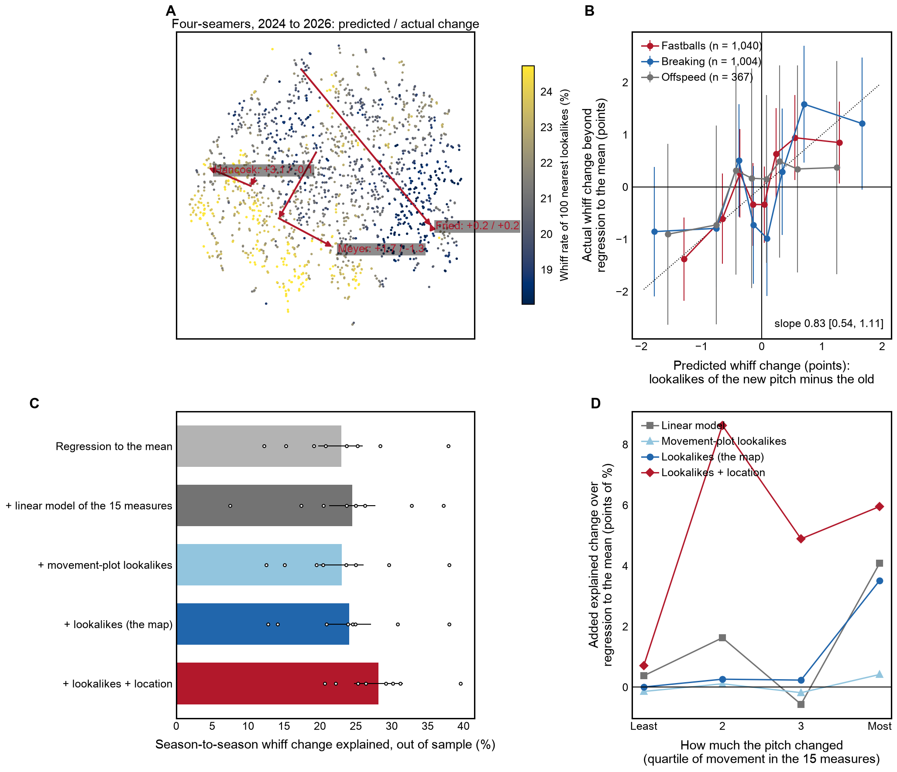

# Pitch-design forecast: does moving on the map predict the whiff change?

*Generated by `scripts/design_forecast.py` on 2026-11-05 13:33 (28 s). Draft numbers; see the module docstring for definitions.*

Sample: 2,411 season-to-season pairs (both seasons >= 100 pitches), 545 pitchers. Target dW = whiff change in points, demeaned within type x season pair (SD 6.72). Predicted change dV has SD 0.89 points.

## 1. Out-of-sample skill (share of the whiff change explained; 95% pitcher-clustered bootstrap)

**Season to season, >= 100 pitches** (2,411 pairs)

| forecast | skill % | 95% CI | vs RTM | vs RTM 95% CI | Spearman |
|---|---|---|---|---|---|
| Regression to the mean | 22.96 | [19.8, 25.9] | 0.00 | [+0.0, +0.0] | 0.45 |
| + linear model of the 15 measures | 24.49 | [21.3, 27.7] | 1.53 | [+0.3, +2.8] | 0.47 |
| + movement-plot lookalikes | 23.03 | [19.9, 26.1] | 0.07 | [-0.2, +0.3] | 0.45 |
| + lookalikes (the map) | 24.09 | [20.9, 27.1] | 1.13 | [+0.3, +1.9] | 0.46 |
| + lookalikes + location | 28.14 | [24.7, 31.6] | 5.18 | [+3.2, +7.1] | 0.50 |

**Season to season, >= 40 pitches** (3,431 pairs)

| forecast | skill % | 95% CI | vs RTM | vs RTM 95% CI | Spearman |
|---|---|---|---|---|---|
| Regression to the mean | 26.20 | [23.4, 29.0] | 0.00 | [+0.0, +0.0] | 0.48 |
| + linear model of the 15 measures | 28.15 | [25.3, 31.0] | 1.95 | [+1.0, +3.0] | 0.50 |
| + movement-plot lookalikes | 26.09 | [23.3, 28.9] | -0.10 | [-0.2, +0.0] | 0.48 |
| + lookalikes (the map) | 27.22 | [24.5, 30.1] | 1.02 | [+0.3, +1.7] | 0.49 |
| + lookalikes + location | 31.21 | [28.1, 34.3] | 5.02 | [+3.4, +6.6] | 0.53 |

**First half to second half, >= 100 pitches** (2,429 pairs)

| forecast | skill % | 95% CI | vs RTM | vs RTM 95% CI | Spearman |
|---|---|---|---|---|---|
| Regression to the mean | 12.77 | [9.7, 15.7] | 0.00 | [+0.0, +0.0] | 0.35 |
| + linear model of the 15 measures | 15.03 | [11.8, 18.1] | 2.27 | [+0.9, +3.6] | 0.38 |
| + movement-plot lookalikes | 12.60 | [9.5, 15.6] | -0.16 | [-0.4, +0.0] | 0.34 |
| + lookalikes (the map) | 13.43 | [10.4, 16.4] | 0.67 | [+0.0, +1.3] | 0.36 |
| + lookalikes + location | 17.86 | [14.1, 21.3] | 5.09 | [+3.1, +7.1] | 0.41 |

Permuted dV (shuffled within type, 20 draws): added skill over RTM mean -0.01, max +0.23 points of %.

## 2. Calibration: whiff change per point of predicted change (given regression to the mean)

| forecast | label | slope | lo | hi | n | pitchers | sd_change |
|---|---|---|---|---|---|---|---|
| dV | lookalikes (the map) | 0.827 | 0.544 | 1.110 | 2411 | 545 | 0.894 |
| dLin | linear model | 0.592 | 0.448 | 0.737 | 2411 | 545 | 1.859 |
| dVm | movement-plot lookalikes | 0.228 | 0.002 | 0.454 | 2411 | 545 | 1.045 |

A slope of 1 means a predicted +1 whiff point arrives as +1 actual point; below 1 means the forecast overstates the change (some of the move is noise in the measures, or the lookalike value is noisy).

## 2b. Neighbours behind the value surface (season to season; added skill in points of %)

| neighbours | added_skill_lookalike | added_skill_with_location | calibration_slope | slope_lo | slope_hi |
|---|---|---|---|---|---|
| 30.00 | 1.00 | 5.33 | 0.43 | 0.26 | 0.61 |
| 60.00 | 1.38 | 5.58 | 0.70 | 0.47 | 0.93 |
| 100.00 | 1.13 | 5.18 | 0.83 | 0.54 | 1.11 |
| 200.00 | 1.95 | 5.85 | 1.53 | 1.16 | 1.90 |

## 3. By how much the pitch changed (quartiles of movement in the 15-measure space)

| move_quartile | n | median_move | sd_dV | gain_linear | gain_movement | gain_lookalike | gain_lookalike_loc | slope_dV | slope_lo | slope_hi |
|---|---|---|---|---|---|---|---|---|---|---|
| 1.000 | 606.000 | 0.338 | 0.505 | 0.004 | -0.001 | 0.000 | 0.007 | 0.571 | -0.489 | 1.631 |
| 2.000 | 602.000 | 0.482 | 0.712 | 0.016 | 0.001 | 0.003 | 0.086 | 0.626 | -0.158 | 1.411 |
| 3.000 | 600.000 | 0.630 | 0.897 | -0.006 | -0.002 | 0.002 | 0.049 | 0.483 | -0.078 | 1.044 |
| 4.000 | 603.000 | 0.951 | 1.277 | 0.041 | 0.004 | 0.035 | 0.060 | 1.127 | 0.715 | 1.540 |

## 4. Per pitch type, season to season (skill, % explained)

| forecast | skill_FF | skill_SI | skill_FC | skill_SL | skill_ST | skill_CU | skill_CH | skill_FS |
|---|---|---|---|---|---|---|---|---|
| rtm | 20.8 | 37.8 | 28.4 | 19.1 | 23.7 | 15.2 | 25.2 | 12.3 |
| linear | 23.7 | 37.2 | 32.8 | 20.5 | 25.0 | 17.4 | 26.2 | 7.5 |
| movement | 20.4 | 38.0 | 29.6 | 19.5 | 23.6 | 15.1 | 25.0 | 12.5 |
| lookalike | 23.9 | 38.0 | 30.8 | 20.9 | 24.5 | 14.1 | 25.0 | 12.7 |
| lookalike_loc | 26.4 | 39.6 | 30.1 | 25.3 | 31.2 | 22.2 | 29.2 | 20.7 |

## 5. Worked examples (Fig. 2B pitchers; points)

| player_name_0 | pitch_type | pair | whiff_0 | whiff_1 | dW_raw | V_0 | V_1 | dV | dH | move |
|---|---|---|---|---|---|---|---|---|---|---|
| Nola, Aaron | CH | 2024->2025 | 13.49 | 30.65 | 17.15 | 25.71 | 25.90 | 0.20 | 0.10 | 0.30 |
| Fried, Max | CH | 2024->2025 | 25.13 | 28.83 | 3.71 | 30.15 | 30.98 | 0.83 | 1.03 | 0.53 |
| Hancock, Emerson | CH | 2024->2025 | 23.93 | 26.87 | 2.93 | 27.69 | 26.67 | -1.02 | -2.51 | 0.97 |
| Meyer, Max | CH | 2024->2025 | 23.53 | 21.33 | -2.20 | 30.82 | 29.49 | -1.33 | -0.54 | 1.36 |
| Nola, Aaron | CU | 2024->2025 | 37.10 | 39.13 | 2.03 | 32.78 | 32.99 | 0.21 | 0.31 | 0.32 |
| Fried, Max | CU | 2024->2025 | 37.02 | 41.95 | 4.93 | 29.27 | 29.17 | -0.09 | -1.70 | 0.39 |
| Nola, Aaron | FC | 2024->2025 | 18.12 | 27.42 | 9.30 | 20.37 | 21.08 | 0.70 | 3.43 | 0.45 |
| Fried, Max | FC | 2024->2025 | 29.79 | 18.82 | -10.97 | 24.69 | 21.12 | -3.57 | 6.71 | 2.27 |
| Gausman, Kevin | FF | 2024->2025 | 17.52 | 16.92 | -0.60 | 21.35 | 21.43 | 0.09 | -0.57 | 0.25 |
| Nola, Aaron | FF | 2024->2025 | 22.86 | 14.07 | -8.79 | 23.88 | 23.81 | -0.07 | -1.34 | 0.26 |
| Fried, Max | FF | 2024->2025 | 17.85 | 24.38 | 6.53 | 18.90 | 19.13 | 0.22 | 2.81 | 1.66 |
| Matsui, Yuki | FF | 2024->2025 | 19.48 | 17.96 | -1.52 | 19.84 | 19.87 | 0.03 | -1.65 | 0.25 |
| Hancock, Emerson | FF | 2024->2025 | 23.56 | 23.04 | -0.52 | 20.43 | 22.17 | 1.74 | 2.65 | 0.91 |
| Meyer, Max | FF | 2024->2025 | 13.81 | 14.04 | 0.22 | 20.79 | 22.72 | 1.93 | 1.94 | 1.26 |
| Gausman, Kevin | FS | 2024->2025 | 33.76 | 38.56 | 4.81 | 31.95 | 32.08 | 0.13 | 0.53 | 0.64 |
| Matsui, Yuki | FS | 2024->2025 | 41.09 | 44.86 | 3.78 | 34.10 | 33.51 | -0.59 | -0.16 | 1.14 |
| Nola, Aaron | SI | 2024->2025 | 12.94 | 10.34 | -2.59 | 12.13 | 12.38 | 0.25 | 0.44 | 0.30 |
| Fried, Max | SI | 2024->2025 | 14.56 | 24.81 | 10.25 | 14.45 | 14.23 | -0.22 | -3.65 | 1.14 |
| Hancock, Emerson | SI | 2024->2025 | 13.24 | 10.19 | -3.05 | 12.91 | 13.03 | 0.11 | -0.69 | 1.06 |
| Gausman, Kevin | SL | 2024->2025 | 26.58 | 37.63 | 11.05 | 33.34 | 33.20 | -0.13 | 0.79 | 0.64 |
| Matsui, Yuki | SL | 2024->2025 | 44.76 | 23.08 | -21.68 | 29.56 | 30.59 | 1.03 | 3.61 | 0.64 |
| Hancock, Emerson | SL | 2024->2025 | 32.61 | 32.47 | -0.14 | 28.75 | 30.88 | 2.13 | 1.75 | 1.08 |
| Meyer, Max | SL | 2024->2025 | 34.33 | 43.16 | 8.83 | 35.60 | 36.16 | 0.56 | 0.06 | 0.54 |
| Fried, Max | ST | 2024->2025 | 32.81 | 36.44 | 3.63 | 29.98 | 28.72 | -1.26 | 4.46 | 1.07 |
| Nola, Aaron | CH | 2025->2026 | 30.65 | 25.57 | -5.07 | 25.90 | 25.56 | -0.34 | -0.39 | 0.28 |
| Fried, Max | CH | 2025->2026 | 28.83 | 31.13 | 2.30 | 30.98 | 31.39 | 0.41 | 0.17 | 0.60 |
| Hancock, Emerson | CH | 2025->2026 | 26.87 | 21.43 | -5.44 | 26.67 | 26.36 | -0.30 | -1.16 | 0.92 |
| Meyer, Max | CH | 2025->2026 | 21.33 | 33.75 | 12.42 | 29.49 | 28.48 | -1.01 | 1.75 | 1.06 |
| Nola, Aaron | CU | 2025->2026 | 39.13 | 41.20 | 2.07 | 32.99 | 33.21 | 0.23 | -1.16 | 0.16 |
| Fried, Max | CU | 2025->2026 | 41.95 | 29.21 | -12.74 | 29.17 | 29.12 | -0.05 | 1.79 | 0.48 |
| Nola, Aaron | FC | 2025->2026 | 27.42 | 25.22 | -2.20 | 21.08 | 21.29 | 0.22 | 0.64 | 0.52 |
| Fried, Max | FC | 2025->2026 | 18.82 | 27.08 | 8.27 | 21.12 | 22.72 | 1.61 | 0.98 | 0.77 |
| Gausman, Kevin | FF | 2025->2026 | 16.92 | 14.82 | -2.10 | 21.43 | 21.03 | -0.40 | 0.33 | 0.27 |
| Nola, Aaron | FF | 2025->2026 | 14.07 | 14.24 | 0.17 | 23.81 | 24.55 | 0.74 | -2.54 | 0.27 |
| Fried, Max | FF | 2025->2026 | 24.38 | 18.06 | -6.32 | 19.13 | 19.11 | -0.02 | -2.01 | 0.54 |
| Matsui, Yuki | FF | 2025->2026 | 17.96 | 22.61 | 4.65 | 19.87 | 19.89 | 0.02 | -1.94 | 0.23 |
| Hancock, Emerson | FF | 2025->2026 | 23.04 | 23.44 | 0.40 | 22.17 | 23.54 | 1.37 | -3.95 | 1.37 |
| Meyer, Max | FF | 2025->2026 | 14.04 | 12.50 | -1.54 | 22.72 | 22.47 | -0.25 | -3.03 | 0.92 |
| Gausman, Kevin | FS | 2025->2026 | 38.56 | 42.28 | 3.72 | 32.08 | 33.00 | 0.92 | -1.22 | 0.47 |
| Matsui, Yuki | FS | 2025->2026 | 44.86 | 47.06 | 2.19 | 33.51 | 33.99 | 0.48 | -1.70 | 0.33 |
| Nola, Aaron | SI | 2025->2026 | 10.34 | 12.20 | 1.85 | 12.38 | 12.56 | 0.19 | -1.72 | 0.28 |
| Fried, Max | SI | 2025->2026 | 24.81 | 19.08 | -5.74 | 14.23 | 13.95 | -0.28 | -0.40 | 0.38 |
| Hancock, Emerson | SI | 2025->2026 | 10.19 | 11.81 | 1.62 | 13.03 | 12.74 | -0.28 | -2.25 | 1.14 |
| Meyer, Max | SI | 2025->2026 | 21.13 | 5.06 | -16.06 | 13.87 | 12.05 | -1.82 | 3.62 | 0.99 |
| Gausman, Kevin | SL | 2025->2026 | 37.63 | 36.17 | -1.46 | 33.20 | 34.13 | 0.92 | -2.21 | 0.64 |
| Matsui, Yuki | SL | 2025->2026 | 23.08 | 35.29 | 12.22 | 30.59 | 28.80 | -1.79 | -4.21 | 1.09 |
| Meyer, Max | SL | 2025->2026 | 43.16 | 39.57 | -3.58 | 36.16 | 36.67 | 0.51 | 1.30 | 0.82 |
| Fried, Max | ST | 2025->2026 | 36.44 | 31.34 | -5.10 | 28.72 | 29.42 | 0.70 | -0.89 | 0.50 |
| Meyer, Max | ST | 2025->2026 | 15.38 | 35.80 | 20.41 | 30.35 | 31.39 | 1.04 | -2.98 | 1.46 |
