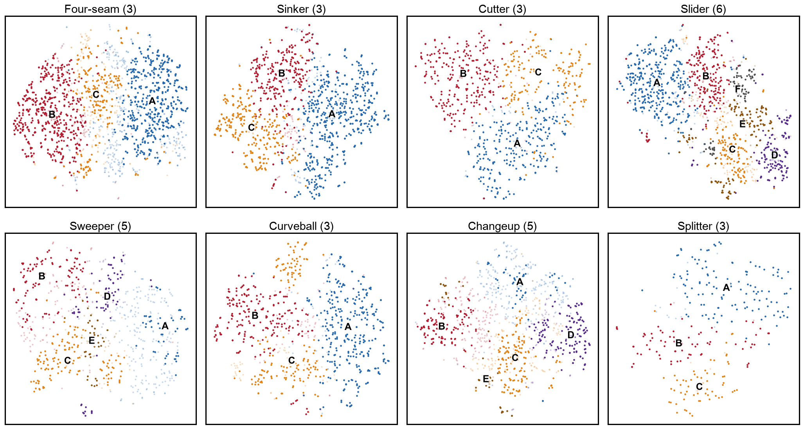

# Clusters and subclusters within each pitch type (consensus)

*Generated by `scripts/pitch_subclusters.py` on 2026-11-05 16:27 (512 s). MLB 2024-2026; identity measures only (what the pitch is); results never used. Names are generated from markers.*

Figure 7. Each pitch type's t-SNE map (the atlas's), coloured by consensus cluster; solid dots are core members (confidence >= 0.6), faint dots edge members. Letters sit at each cluster's core.

Reproducibility: adjusted Rand index between the clusters cut from two independent consensus matrices (30 resamples each, 20% of pitchers left out each time). PAC: share of pitch pairs that are ambiguous (together in 10-90% of resamples). Core: share of pitches with confidence >= 0.6. Same next season: a pitcher's same pitch in the same cluster the following season, against chance.

| Pitch type | Rows | Clusters | Resolution | Reproducibility | PAC | Core | Same next season | Chance |
|---|---|---|---|---|---|---|---|---|
| Four-seam | 1,850 | 3 | 0.4 | 0.77 | 0.66 | 67% | 88% | 37% |
| Sinker | 1,235 | 3 | 0.4 | 0.84 | 0.61 | 90% | 89% | 38% |
| Cutter | 722 | 3 | 0.5 | 0.90 | 0.47 | 94% | 83% | 35% |
| Slider | 1,253 | 6 | 0.7 | 0.93 | 0.33 | 84% | 78% | 20% |
| Sweeper | 742 | 5 | 0.7 | 0.80 | 0.45 | 53% | 81% | 24% |
| Curveball | 789 | 3 | 0.4 | 0.89 | 0.67 | 85% | 86% | 35% |
| Changeup | 1,021 | 5 | 0.7 | 0.69 | 0.45 | 47% | 87% | 24% |
| Splitter | 277 | 3 | 0.5 | 0.88 | 0.39 | 94% | 91% | 37% |

## Four-seam

- **A** · High slot, more ride (873; core 500) · 94.7 mph · ride 17.0 in · run 6.7 in · 2313 rpm · arm angle 47° · 2 subclusters (reproducibility 0.86)
  - **A1** · More glove-side, less ride for the slot (469; core 451) · 94.0 mph · ride 17.1 in · run 4.7 in · 2291 rpm · arm angle 51°
  - **A2** · More arm-side run, more ride for the slot (404; core 393) · 95.6 mph · ride 16.9 in · run 9.0 in · 2338 rpm · arm angle 42°
- **B** · Low slot, more arm-side run (583; core 515) · 94.1 mph · ride 13.2 in · run 10.7 in · 2279 rpm · arm angle 27° · 3 subclusters (reproducibility 0.94)
  - **B1** · Lower release, less ride (228; core 209) · 92.9 mph · ride 11.8 in · run 11.3 in · 2281 rpm · arm angle 18°
  - **B2** · More ride for the slot, shorter extension (191; core 187) · 94.8 mph · ride 14.6 in · run 10.0 in · 2366 rpm · arm angle 30°
  - **B3** · Less spin, higher release (164; core 158) · 95.1 mph · ride 13.5 in · run 10.8 in · 2176 rpm · arm angle 34°
- **C** · Less run than slot (394; core 221) · 93.8 mph · ride 15.1 in · run 5.5 in · 2312 rpm · arm angle 39° · 4 subclusters (reproducibility 0.92)
  - **C1** · More ride for the slot, flatter (154; core 105) · 94.8 mph · ride 16.3 in · run 5.6 in · 2344 rpm · arm angle 39°
  - **C2** · Less ride for the slot, less spin (110; core 85) · 92.5 mph · ride 13.9 in · run 5.8 in · 2223 rpm · arm angle 38°
  - **C3** · Shorter extension, more run for the slot (87; core 76) · 94.5 mph · ride 15.9 in · run 7.1 in · 2328 rpm · arm angle 40°
  - **C4** · Less ride for the slot, less run for the slot (43; core 41) · 92.3 mph · ride 12.3 in · run 0.8 in · 2391 rpm · arm angle 42°

## Sinker

- **A** · High slot, more ride (619; core 549) · 93.8 mph · ride 10.5 in · run 13.8 in · 2198 rpm · arm angle 42° · 5 subclusters (reproducibility 0.75)
  - **A1** · Flatter, more ride for the slot (167; core 0) · 95.0 mph · ride 11.5 in · run 14.3 in · 2208 rpm · arm angle 39°
  - **A2** · More glove-side, more spin (159; core 67) · 94.3 mph · ride 11.9 in · run 11.7 in · 2271 rpm · arm angle 46°
  - **A3** · Less ride for the slot, steeper (105; core 100) · 92.7 mph · ride 7.0 in · run 14.1 in · 2132 rpm · arm angle 42°
  - **A4** · Shorter extension, more arm-side run (102; core 63) · 93.9 mph · ride 10.2 in · run 14.9 in · 2249 rpm · arm angle 39°
  - **A5** · Less spin, softer (86; core 42) · 92.1 mph · ride 10.5 in · run 14.8 in · 2066 rpm · arm angle 41°
- **B** · Run beyond slot, flat approach (335; core 279) · 94.8 mph · ride 7.9 in · run 16.5 in · 2232 rpm · arm angle 29° · 5 subclusters (reproducibility 0.96)
  - **B1** · Flatter, lower release (110; core 1) · 94.2 mph · ride 7.3 in · run 16.8 in · 2209 rpm · arm angle 25°
  - **B2** · Shorter extension, softer (69; core 54) · 93.4 mph · ride 8.1 in · run 16.5 in · 2228 rpm · arm angle 31°
  - **B3** · More ride for the slot, more spin (59; core 53) · 96.3 mph · ride 9.8 in · run 16.2 in · 2339 rpm · arm angle 31°
  - **B4** · Less ride for the slot, longer extension (53; core 53) · 95.3 mph · ride 6.9 in · run 15.9 in · 2192 rpm · arm angle 33°
  - **B5** · Steeper, higher release (44; core 38) · 95.7 mph · ride 7.7 in · run 17.3 in · 2200 rpm · arm angle 29°
- **C** · Less ride, low slot (281; core 281) · 92.4 mph · ride 2.7 in · run 16.1 in · 2151 rpm · arm angle 19° · 2 subclusters (reproducibility 0.90)
  - **C1** · Higher release, steeper (182; core 181) · 92.6 mph · ride 3.8 in · run 16.0 in · 2125 rpm · arm angle 26°
  - **C2** · Lower release, flatter (99; core 97) · 92.0 mph · ride 0.8 in · run 16.3 in · 2198 rpm · arm angle 6°

## Cutter

- **A** · Run beyond slot, ride beyond slot (284; core 263) · 90.8 mph · ride 9.9 in · run -0.9 in · 2339 rpm · arm angle 41° · 2 subclusters (reproducibility 0.94)
  - **A1** · Higher slot, more glove-side (155; core 143) · 90.4 mph · ride 9.8 in · run -1.9 in · 2298 rpm · arm angle 47°
  - **A2** · Lower slot, more arm-side run (129; core 125) · 91.3 mph · ride 9.9 in · run 0.3 in · 2388 rpm · arm angle 34°
- **B** · More glove-side break, less ride than slot (261; core 244) · 88.5 mph · ride 5.8 in · run -3.8 in · 2438 rpm · arm angle 42° · 2 subclusters (reproducibility 0.94)
  - **B1** · Less ride for the slot, softer (136; core 121) · 87.3 mph · ride 4.2 in · run -3.8 in · 2375 rpm · arm angle 43°
  - **B2** · More ride for the slot, harder (125; core 121) · 89.8 mph · ride 7.4 in · run -3.9 in · 2507 rpm · arm angle 41°
- **C** · Low slot, flat approach (177; core 169) · 89.1 mph · ride 7.4 in · run -1.3 in · 2382 rpm · arm angle 27° · 2 subclusters (reproducibility 0.95)
  - **C1** · Higher release, steeper (117; core 117) · 89.1 mph · ride 6.9 in · run -1.8 in · 2392 rpm · arm angle 30°
  - **C2** · Lower release, flatter (60; core 60) · 89.0 mph · ride 8.1 in · run -0.4 in · 2361 rpm · arm angle 21°

## Slider

- **A** · Ride beyond slot, more arm-side run (398; core 357) · 87.2 mph · ride 4.3 in · run -2.7 in · 2324 rpm · arm angle 40° · 2 subclusters (reproducibility 0.85)
  - **A1** · Lower release, flatter (212; core 184) · 87.5 mph · ride 4.5 in · run -2.9 in · 2354 rpm · arm angle 35°
  - **A2** · Higher release, steeper (186; core 165) · 86.8 mph · ride 4.2 in · run -2.5 in · 2289 rpm · arm angle 46°
- **B** · High slot (238; core 209) · 86.9 mph · ride 1.8 in · run -4.7 in · 2469 rpm · arm angle 48° · 2 subclusters (reproducibility 0.97)
  - **B1** · Less ride for the slot, more spin (162; core 127) · 86.8 mph · ride 1.1 in · run -4.4 in · 2510 rpm · arm angle 45°
  - **B2** · More ride for the slot, less spin (76; core 72) · 87.1 mph · ride 3.3 in · run -5.4 in · 2383 rpm · arm angle 53°
- **C** · Less ride, steep approach (223; core 130) · 85.1 mph · ride -2.2 in · run -4.2 in · 2584 rpm · arm angle 42° · 2 subclusters (reproducibility 0.91)
  - **C1** · Flatter, lower slot (125; core 80) · 85.8 mph · ride -1.5 in · run -3.9 in · 2607 rpm · arm angle 37°
  - **C2** · Steeper, higher slot (98; core 85) · 84.3 mph · ride -3.0 in · run -4.7 in · 2554 rpm · arm angle 48°
- **D** · More glove-side break, softer (153; core 146) · 83.6 mph · ride 2.9 in · run -9.2 in · 2509 rpm · arm angle 30° · 3 subclusters (reproducibility 0.94)
  - **D1** · Less run for the slot, higher release (68; core 58) · 85.2 mph · ride 1.8 in · run -10.6 in · 2662 rpm · arm angle 38°
  - **D2** · More arm-side run, higher release (47; core 45) · 84.5 mph · ride 4.2 in · run -6.2 in · 2410 rpm · arm angle 34°
  - **D3** · Lower release, softer (38; core 35) · 79.5 mph · ride 3.4 in · run -10.3 in · 2358 rpm · arm angle 10°
- **E** · Low release, less ride than slot (153; core 135) · 85.4 mph · ride 0.3 in · run -4.4 in · 2423 rpm · arm angle 29° · 4 subclusters (reproducibility 0.94)
  - **E1** · Shorter extension, more arm-side run (55; core 44) · 85.4 mph · ride 0.7 in · run -2.9 in · 2453 rpm · arm angle 26°
  - **E2** · Longer extension, less spin (43; core 36) · 84.4 mph · ride -1.0 in · run -4.7 in · 2324 rpm · arm angle 31°
  - **E3** · Longer extension, more glove-side (33; core 25) · 85.6 mph · ride 1.2 in · run -5.4 in · 2386 rpm · arm angle 32°
  - **E4** · More spin, less run for the slot (22; core 22) · 87.0 mph · ride 0.4 in · run -6.2 in · 2597 rpm · arm angle 29°
- **F** · Low spin, run beyond slot (88; core 80) · 86.0 mph · ride -0.3 in · run -1.8 in · 2175 rpm · arm angle 41° · 2 subclusters (reproducibility 1.00)
  - **F1** · More ride, flatter (51; core 51) · 86.2 mph · ride 1.5 in · run -2.3 in · 2214 rpm · arm angle 40°
  - **F2** · Less ride, steeper (37; core 37) · 85.7 mph · ride -2.6 in · run -1.1 in · 2122 rpm · arm angle 42°

## Sweeper

- **A** · Less ride, steep approach (245; core 49) · 82.9 mph · ride -2.1 in · run -13.3 in · 2580 rpm · arm angle 39° · not split
- **B** · Low release, flat approach (192; core 108) · 80.7 mph · ride 2.9 in · run -13.9 in · 2538 rpm · arm angle 17° · 3 subclusters (reproducibility 0.91)
  - **B1** · Less ride, steeper (66; core 59) · 80.4 mph · ride 0.5 in · run -15.0 in · 2523 rpm · arm angle 22°
  - **B2** · More arm-side run, more ride for the slot (65; core 61) · 81.2 mph · ride 5.2 in · run -11.4 in · 2449 rpm · arm angle 21°
  - **B3** · Shorter extension, lower slot (61; core 51) · 80.6 mph · ride 3.0 in · run -15.4 in · 2650 rpm · arm angle 8°
- **C** · Ride beyond slot, more arm-side run (151; core 130) · 83.2 mph · ride 3.9 in · run -12.2 in · 2496 rpm · arm angle 37° · 2 subclusters (reproducibility 0.97)
  - **C1** · Less ride for the slot, steeper (105; core 105) · 82.8 mph · ride 2.7 in · run -12.8 in · 2510 rpm · arm angle 39°
  - **C2** · More ride for the slot, flatter (46; core 46) · 84.3 mph · ride 6.5 in · run -10.6 in · 2462 rpm · arm angle 33°
- **D** · More glove-side break, high spin (92; core 70) · 81.5 mph · ride 0.1 in · run -16.5 in · 2732 rpm · arm angle 32° · 2 subclusters (reproducibility 1.00)
  - **D1** · Shorter extension, softer (52; core 49) · 80.2 mph · ride 0.2 in · run -15.7 in · 2651 rpm · arm angle 32°
  - **D2** · Longer extension, harder (40; core 40) · 83.1 mph · ride -0.1 in · run -17.5 in · 2837 rpm · arm angle 32°
- **E** · Short extension, ride beyond slot (62; core 36) · 83.5 mph · ride 2.5 in · run -13.8 in · 2680 rpm · arm angle 29° · not split

## Curveball

- **A** · Steep approach, less ride (328; core 301) · 79.2 mph · ride -13.7 in · run -8.5 in · 2634 rpm · arm angle 50° · not split
- **B** · Low release, flat approach (253; core 206) · 80.4 mph · ride -8.8 in · run -10.4 in · 2558 rpm · arm angle 35° · 2 subclusters (reproducibility 1.00)
  - **B1** · Higher slot, less ride (127; core 127) · 80.7 mph · ride -10.6 in · run -8.5 in · 2475 rpm · arm angle 41°
  - **B2** · Lower slot, more ride (126; core 125) · 80.0 mph · ride -6.9 in · run -12.2 in · 2642 rpm · arm angle 29°
- **C** · Ride beyond slot, more arm-side run (208; core 160) · 81.6 mph · ride -6.2 in · run -6.0 in · 2430 rpm · arm angle 46° · 2 subclusters (reproducibility 1.00)
  - **C1** · More run for the slot, less spin (134; core 129) · 82.2 mph · ride -6.2 in · run -3.4 in · 2384 rpm · arm angle 46°
  - **C2** · Less run for the slot, more spin (74; core 74) · 80.7 mph · ride -6.4 in · run -10.9 in · 2511 rpm · arm angle 47°

## Changeup

- **A** · Ride beyond slot, run beyond slot (270; core 51) · 87.2 mph · ride 7.2 in · run 15.5 in · 1911 rpm · arm angle 37° · 2 subclusters (reproducibility 0.96)
  - **A1** · Softer, more ride (171; core 159) · 85.8 mph · ride 8.4 in · run 15.2 in · 1931 rpm · arm angle 39°
  - **A2** · Harder, less ride (99; core 99) · 89.6 mph · ride 5.1 in · run 16.0 in · 1874 rpm · arm angle 34°
- **B** · Low slot, less ride (265; core 113) · 85.4 mph · ride 1.0 in · run 15.2 in · 1762 rpm · arm angle 23° · 2 subclusters (reproducibility 0.84)
  - **B1** · Higher release, shorter extension (139; core 139) · 86.2 mph · ride 1.3 in · run 14.4 in · 1672 rpm · arm angle 27°
  - **B2** · Lower release, longer extension (126; core 126) · 84.6 mph · ride 0.7 in · run 16.0 in · 1861 rpm · arm angle 18°
- **C** · Less ride than slot, more glove-side break (263; core 138) · 87.0 mph · ride 3.1 in · run 12.5 in · 1597 rpm · arm angle 39° · 2 subclusters (reproducibility 0.83)
  - **C1** · Less run for the slot, less spin (201; core 191) · 86.5 mph · ride 3.0 in · run 11.9 in · 1515 rpm · arm angle 39°
  - **C2** · More run for the slot, more spin (62; core 62) · 88.9 mph · ride 3.7 in · run 14.3 in · 1863 rpm · arm angle 42°
- **D** · More ride, high slot (180; core 135) · 84.2 mph · ride 9.0 in · run 12.8 in · 1726 rpm · arm angle 47° · 5 subclusters (reproducibility 0.78)
  - **D1** · More run for the slot, harder (47; core 27) · 86.3 mph · ride 7.0 in · run 14.6 in · 1813 rpm · arm angle 45°
  - **D2** · Shorter extension, less ride for the slot (39; core 21) · 82.1 mph · ride 7.1 in · run 13.3 in · 1670 rpm · arm angle 47°
  - **D3** · More ride for the slot, flatter (38; core 34) · 86.1 mph · ride 11.5 in · run 11.0 in · 1700 rpm · arm angle 46°
  - **D4** · Longer extension, softer (29; core 20) · 81.1 mph · ride 9.9 in · run 11.4 in · 1572 rpm · arm angle 48°
  - **D5** · Higher release, more spin (27; core 23) · 84.6 mph · ride 10.7 in · run 12.9 in · 1859 rpm · arm angle 55°
- **E** · Steep approach, less ride than slot (43; core 39) · 83.5 mph · ride 2.5 in · run 15.1 in · 1931 rpm · arm angle 36° · not split

## Splitter

- **A** · Less run than slot, low spin (136; core 123) · 85.1 mph · ride 1.4 in · run 9.3 in · 1126 rpm · arm angle 38° · 3 subclusters (reproducibility 0.90)
  - **A1** · Steeper, higher release (66; core 47) · 84.5 mph · ride 1.3 in · run 7.6 in · 945 rpm · arm angle 44°
  - **A2** · Lower slot, more spin (51; core 48) · 85.7 mph · ride 0.3 in · run 11.4 in · 1367 rpm · arm angle 29°
  - **A3** · More ride for the slot, flatter (19; core 19) · 85.6 mph · ride 4.6 in · run 9.5 in · 1113 rpm · arm angle 39°
- **B** · More ride, high slot (76; core 74) · 86.6 mph · ride 6.4 in · run 9.9 in · 1379 rpm · arm angle 49° · 2 subclusters (reproducibility 0.75)
  - **B1** · More ride, longer extension (39; core 32) · 86.2 mph · ride 8.0 in · run 9.1 in · 1323 rpm · arm angle 53°
  - **B2** · Less ride, shorter extension (37; core 36) · 87.0 mph · ride 4.8 in · run 10.8 in · 1439 rpm · arm angle 45°
- **C** · Run beyond slot, high spin (65; core 62) · 89.0 mph · ride 3.2 in · run 13.8 in · 1649 rpm · arm angle 35° · 3 subclusters (reproducibility 1.00)
  - **C1** · More ride for the slot, higher release (34; core 0) · 89.6 mph · ride 4.4 in · run 14.2 in · 1688 rpm · arm angle 37°
  - **C2** · Less ride for the slot, steeper (16; core 15) · 88.8 mph · ride 1.0 in · run 12.7 in · 1512 rpm · arm angle 38°
  - **C3** · Lower release, flatter (15; core 15) · 87.9 mph · ride 2.8 in · run 14.3 in · 1706 rpm · arm angle 29°

## Do the clusters recover the hand-written pitch tags?

Pitches meeting each old rule (approximated on season means) and the subclusters they fall in.

| Old tag | Pitches | Main subclusters |
|---|---|---|
| Gyro / bullet slider | 452 | SL-A2 17%, SL-A1 17%, SL-C1 14% |
| Kick-change | 167 | CH-C1 30%, CH-A2 23%, CH-C2 19% |
| Splinker / power splitter | 53 | FS-C1 34%, FS-C2 15%, FS-B1 13% |
| Turbo sinker | 227 | SI-A1 22%, SI-B3 16%, SI-A2 14% |
| Ride beyond slot | 344 | FF-A2 52%, FF-A1 21%, FF-C1 10% |
| Cut-ride fastball | 216 | FF-A1 84%, FF-C1 13%, FF-A2 2% |
| Flat VAA fastball | 117 | FF-B1 60%, FF-B2 16%, FF-A2 15% |

sweep.csv: every resolution tried at both levels (clusters, reproducibility, PAC, core share, persistence).