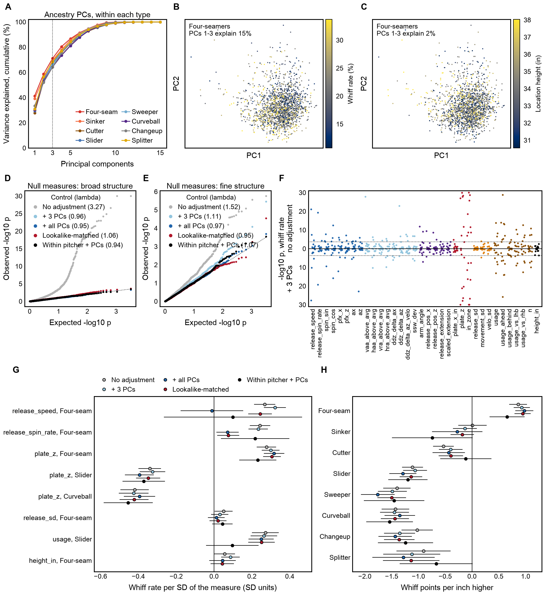

# Pitch ancestry: GWAS-style control for population structure

*Generated by `scripts/stratification_scan.py` on 2026-11-05 10:07 (128 s). Draft numbers for review; the narrative is to be written after reading them.*

Analogy: measure = SNP, whiff rate (rank-inverse-normal within type) = phenotype, PCs of the 15 identity measures within pitch type = ancestry PCs, pitch type = continental group (analysed separately, never pooled), rows of one pitcher = relatives (SEs clustered by pitcher), leave-one-block-out PCs for identity measures = LOCO. See the module docstring.

## 1. Inflation (lambda_GC) by control

Real measures include true effects, so their lambda need not reach 1; the synthetic nulls and the permuted phenotype should.

| model | real_whiff_pct | real_csw_pct | real_xwoba_contact | real_rv100_raw | null_broad | null_fine | permuted |
|---|---|---|---|---|---|---|---|
| type | 8.99 | 13.16 | 5.49 | 4.83 | 3.27 | 1.52 | 0.99 |
| pc3 | 8.36 | 12.39 | 4.28 | 6.02 | 0.96 | 1.11 | 1.04 |
| pcall | 5.08 | 6.09 | 2.89 | 2.77 | 0.95 | 0.97 | 0.96 |
| lookalike | 5.72 | 6.28 | 3.25 | 3.67 | 1.06 | 0.95 | 0.99 |
| within | 3.04 | 4.36 | 1.49 | 2.78 | 0.94 | 1.07 | 1.05 |

## 2. Case examples, whiff rate, SD units (beta [95% CI])

| variable | type | No adjustment | + 3 PCs | + all PCs | Lookalike-matched | Within pitcher + PCs |
|---|---|---|---|---|---|---|
| height_in | FF | +0.06 [+0.00, +0.11] | +0.09 [+0.04, +0.13] | +0.04 [-0.02, +0.11] | +0.04 [-0.02, +0.10] | not testable |
| plate_z | CU | -0.42 [-0.49, -0.35] | -0.42 [-0.50, -0.35] | -0.39 [-0.48, -0.31] | -0.42 [-0.50, -0.35] | -0.45 [-0.58, -0.33] |
| plate_z | FF | +0.28 [+0.23, +0.33] | +0.30 [+0.25, +0.34] | +0.32 [+0.27, +0.37] | +0.31 [+0.26, +0.35] | +0.23 [+0.14, +0.33] |
| plate_z | SL | -0.34 [-0.40, -0.28] | -0.32 [-0.39, -0.26] | -0.39 [-0.47, -0.32] | -0.35 [-0.41, -0.29] | -0.37 [-0.48, -0.26] |
| release_sd | FF | +0.05 [+0.00, +0.10] | +0.03 [-0.01, +0.07] | +0.01 [-0.03, +0.05] | +0.02 [-0.02, +0.06] | +0.04 [-0.01, +0.10] |
| release_speed | FF | +0.27 [+0.21, +0.32] | +0.32 [+0.26, +0.38] | -0.01 [-0.18, +0.15] | +0.24 [+0.18, +0.30] | +0.10 [-0.26, +0.46] |
| release_spin_rate | FF | +0.24 [+0.19, +0.30] | +0.23 [+0.18, +0.28] | +0.07 [+0.01, +0.13] | +0.08 [+0.02, +0.13] | +0.22 [+0.04, +0.40] |
| usage | SL | +0.27 [+0.20, +0.34] | +0.26 [+0.19, +0.33] | +0.25 [+0.18, +0.31] | +0.25 [+0.18, +0.32] | +0.10 [-0.04, +0.23] |

## 3. Location height in natural units: whiff points per inch higher

| type | No adjustment | + 3 PCs | + all PCs | Lookalike-matched | Within pitcher + PCs |
|---|---|---|---|---|---|
| FF | +0.86 [+0.70, +1.02] | +0.93 [+0.78, +1.07] | +0.98 [+0.81, +1.14] | +0.95 [+0.80, +1.09] | +0.65 [+0.33, +0.98] |
| SI | +0.01 [-0.25, +0.27] | -0.13 [-0.35, +0.09] | -0.28 [-0.74, +0.19] | -0.18 [-0.39, +0.03] | -0.74 [-1.49, +0.01] |
| FC | -0.53 [-0.72, -0.35] | -0.40 [-0.61, -0.18] | -0.44 [-0.73, -0.14] | -0.39 [-0.62, -0.17] | -0.12 [-0.59, +0.36] |
| SL | -1.11 [-1.30, -0.92] | -1.06 [-1.28, -0.85] | -1.29 [-1.54, -1.04] | -1.14 [-1.34, -0.93] | -1.20 [-1.56, -0.84] |
| ST | -1.40 [-1.65, -1.15] | -1.49 [-1.75, -1.22] | -1.76 [-2.07, -1.45] | -1.50 [-1.76, -1.23] | -1.45 [-2.01, -0.89] |
| CU | -1.43 [-1.68, -1.18] | -1.45 [-1.71, -1.18] | -1.35 [-1.63, -1.07] | -1.44 [-1.70, -1.18] | -1.54 [-1.97, -1.11] |
| CH | -1.02 [-1.31, -0.74] | -1.35 [-1.64, -1.07] | -1.43 [-1.74, -1.12] | -1.36 [-1.64, -1.08] | -1.24 [-1.75, -0.73] |
| FS | -0.90 [-1.40, -0.40] | -1.12 [-1.65, -0.60] | -1.28 [-1.86, -0.70] | -1.14 [-1.66, -0.61] | -0.67 [-1.34, +0.01] |

## 4. Whiff: associations that collapse once pitch ancestry is controlled

Significant with no adjustment (p < 1.8e-04, Bonferroni over 272 tests) and shrinking most with 3 PCs.

| type | variable | beta_type | p_type | beta_pc3 | p_pc3 | shrink |
|---|---|---|---|---|---|---|
| FC | ax | 0.156 | 0.000106 | -0.00631 | 0.925 | 0.959 |
| FC | pfx_x | 0.174 | 1.82e-05 | 0.0207 | 0.748 | 0.881 |
| FC | haa_above_avg | 0.174 | 2.03e-05 | -0.0258 | 0.709 | 0.852 |
| FC | ddz_delta_az | -0.233 | 2.73e-07 | -0.0487 | 0.615 | 0.791 |
| FC | hra_above_avg | -0.164 | 5.31e-05 | 0.0385 | 0.547 | 0.766 |
| FF | vaa_above_avg | 0.303 | 1.63e-28 | 0.103 | 0.00303 | 0.66 |
| FF | usage_ahead | 0.204 | 1.23e-14 | 0.0759 | 0.00432 | 0.628 |
| FC | spin_sin | 0.224 | 1.95e-08 | 0.103 | 0.21 | 0.539 |
| FF | ddz_delta_az_velo | 0.145 | 2.86e-08 | 0.0679 | 0.00996 | 0.533 |
| FF | ddz_delta_az | 0.265 | 1.37e-23 | 0.124 | 8.46e-05 | 0.532 |
| FF | plate_x_in | -0.114 | 1.85e-05 | -0.0601 | 0.0162 | 0.474 |
| FS | release_spin_rate | -0.271 | 6.04e-05 | -0.148 | 0.158 | 0.453 |
| FC | ddz_delta_az_velo | -0.233 | 2.33e-07 | -0.13 | 0.022 | 0.443 |
| CH | vra_above_avg | -0.143 | 4.95e-05 | 0.0869 | 0.326 | 0.391 |
| FC | spin_cos | 0.181 | 1.96e-06 | 0.118 | 0.00481 | 0.348 |

## 5. Whiff: associations that survive every control

| type | variable | No adjustment | + 3 PCs | + all PCs | Lookalike-matched | Within pitcher + PCs |
|---|---|---|---|---|---|---|
| FF | plate_z | +0.28 | +0.30 | +0.32 | +0.31 | +0.23 |
| SL | plate_z | -0.34 | -0.32 | -0.39 | -0.35 | -0.37 |
| SL | in_zone | -0.42 | -0.40 | -0.41 | -0.39 | -0.28 |
| ST | plate_z | -0.39 | -0.42 | -0.49 | -0.42 | -0.40 |
| ST | in_zone | -0.41 | -0.44 | -0.46 | -0.44 | -0.38 |
| CU | release_speed | +0.19 | +0.23 | +0.51 | +0.33 | +1.80 |
| CU | plate_z | -0.42 | -0.42 | -0.39 | -0.42 | -0.45 |
| CU | in_zone | -0.41 | -0.41 | -0.41 | -0.41 | -0.41 |
| CU | usage_ahead | +0.34 | +0.34 | +0.26 | +0.30 | +0.28 |
| CH | plate_z | -0.25 | -0.33 | -0.35 | -0.33 | -0.31 |
| CH | in_zone | -0.24 | -0.29 | -0.31 | -0.31 | -0.26 |

## 6. Count of Bonferroni-significant tests by outcome and control

| outcome | No adjustment | + 3 PCs | + all PCs | Lookalike-matched | Within pitcher + PCs |
|---|---|---|---|---|---|
| csw_pct | 93 | 87 | 65 | 66 | 24 |
| rv100_raw | 41 | 45 | 40 | 40 | 9 |
| whiff_pct | 71 | 61 | 52 | 41 | 17 |
| xwoba_contact | 44 | 31 | 29 | 27 | 5 |

## 7. What the ancestry PCs are (variance explained and top loadings, PCs 1-3)

| type | pc | var_explained | top loadings |
|---|---|---|---|
| CH | 1 | 0.33 | arm_angle +0.45, release_pos_z +0.43, vra_above_avg -0.42 |
| CH | 2 | 0.19 | ddz_delta_az +0.45, ddz_delta_ax -0.43, vaa_above_avg +0.41 |
| CH | 3 | 0.12 | ssw_dev +0.60, release_speed -0.54, ddz_delta_ax +0.33 |
| CU | 1 | 0.30 | arm_angle +0.42, vaa_above_avg -0.41, release_pos_z +0.36 |
| CU | 2 | 0.23 | vra_above_avg +0.44, pfx_x +0.43, ddz_delta_ax +0.40 |
| CU | 3 | 0.11 | ssw_dev +0.51, ddz_delta_ax -0.42, vra_above_avg +0.33 |
| FC | 1 | 0.28 | vaa_above_avg +0.42, spin_sin -0.38, pfx_x -0.34 |
| FC | 2 | 0.25 | vra_above_avg +0.49, release_pos_z -0.40, arm_angle -0.38 |
| FC | 3 | 0.11 | ddz_delta_ax +0.46, release_extension +0.41, pfx_x +0.37 |
| FF | 1 | 0.41 | arm_angle +0.42, release_pos_z +0.40, vra_above_avg -0.38 |
| FF | 2 | 0.17 | ddz_delta_ax +0.54, ddz_delta_az -0.41, ssw_dev +0.40 |
| FF | 3 | 0.12 | vaa_above_avg +0.48, release_spin_rate +0.41, ddz_delta_az +0.38 |
| FS | 1 | 0.31 | arm_angle +0.46, release_pos_z +0.43, vra_above_avg -0.40 |
| FS | 2 | 0.26 | ddz_delta_ax +0.40, ddz_delta_az -0.39, release_spin_rate -0.38 |
| FS | 3 | 0.12 | release_extension +0.52, ssw_dev +0.43, vaa_above_avg +0.36 |
| SI | 1 | 0.39 | arm_angle +0.43, release_pos_z +0.40, vra_above_avg -0.39 |
| SI | 2 | 0.16 | ddz_delta_az +0.54, vaa_above_avg +0.48, ssw_dev +0.47 |
| SI | 3 | 0.14 | ddz_delta_ax +0.57, pfx_x +0.48, release_pos_z -0.29 |
| SL | 1 | 0.29 | vra_above_avg +0.43, release_pos_z -0.41, arm_angle -0.38 |
| SL | 2 | 0.25 | vaa_above_avg +0.45, ddz_delta_az +0.39, pfx_z +0.38 |
| SL | 3 | 0.13 | ddz_delta_ax +0.57, pfx_x +0.47, ddz_delta_az +0.32 |
| ST | 1 | 0.31 | release_pos_z +0.44, arm_angle +0.42, vaa_above_avg -0.40 |
| ST | 2 | 0.21 | ddz_delta_az +0.45, vra_above_avg -0.44, pfx_z +0.32 |
| ST | 3 | 0.13 | ddz_delta_ax +0.53, pfx_x +0.46, release_spin_rate +0.32 |
