# What makes two pitches alike, and how to draw it: a benchmark for the Pitch Universe atlas

*Version 3.1, 2026-11-05. The numbers are those of version 3 (SLURM job 13736586). The figures were redrawn to the Cell
production rules in `figure_aesthetics/` and regrouped into four main figures, one per step of the argument, with the
detail moved to seven supplementary figures. Versions 1 to 2.2 compared maps of the atlas's old 27-measure space and
went through three rounds of independent review (statistics, dimensionality reduction, baseball analytics). Version 3
follows the two decisions those results led to: "similar" means similar in what the pitch is (shape, angles and
delivery, 15 measures), and the atlas is drawn with t-SNE.*

## Summary

The Pitch Universe atlas draws one dot per pitcher-season-pitch-type and lists, for every pitch, its ten
lookalikes. Two questions decide whether those dots and lists mean anything. What should "similar" mean? And
which picture shows that similarity most faithfully? This study answers both on the 2024 to 2026 MLB data:
7,889 dots, eight pitch types. The four main figures take one step each.

1. **Figure 1. Similar should mean what the pitch is, not where it is thrown or how repeatably.** Shape, angle
   and delivery measures repeat from a pitcher's first half to his second at 0.92 to 0.97. Location and release
   or movement scatter repeat at about 0.6. In the atlas's old 27-measure space those two noisy blocks caused 76%
   of a pitcher's season-to-season movement. On the 15 identity measures a pitcher's other season is among his
   ten nearest pitches 89% of the time, against 75% before.

2. **Figure 2. t-SNE draws that similarity most faithfully.** It keeps 48% of a pitch's ten truly nearest
   pitches in 3D and 43% in 2D. UMAP at the atlas's previous settings keeps 44% and 39%, PaCMAP 36% in 3D, two-axis
   PCA 14% and the Savant-style movement plot 10%. The gap to UMAP is four points in both dimensions, with
   intervals of half a point, and no UMAP setting in a 20-cell grid closes it.

3. **Figure 3. New pitchers land where they belong, and the map survives a refresh.** For a pitcher whose earlier
   data is already on the map, t-SNE's own placement puts his new data among the ten dots nearest his old row 88%
   of the time in 3D; averaging his nearest neighbours' positions manages 58%. For a stranger the average is
   better (62% against 54%). The atlas uses each where it wins: 76% of Triple-A call-ups land beside their own
   MLB row on the 3D maps. Restarting t-SNE from the previous layout makes it about as stable as AlignedUMAP
   while keeping 4 to 5 more points of true neighbours.

4. **Figure 4. Same pitch, different location.** Among lookalikes matched on what the pitch is, the gap in
   location height tracks the gap in whiff rate. Four-seamers thrown higher than their lookalikes get more whiffs
   (Spearman +0.33, about one point of whiff rate per inch). Sliders, sweepers, curveballs, changeups and
   splitters thrown lower get more (-0.32 to -0.41, 1.1 to 1.5 points per inch). The relation is about twice as
   strong as when location was part of "similar", because the old definition matched pitches on location and so
   hid its effect.

No picture replaces the full space: the best map keeps half of each pitch's true neighbours. Lookalikes, uniqueness
and rankings are computed on the 15 measures directly, never from map distance.

## 1. Data

One row is one pitcher's version of one pitch type in one season, built from at least 40 pitches
(`mlbpitch.profiles`): 7,889 rows over 2024 to 2026 (four-seam 1,850; slider 1,253; sinker 1,235; changeup 1,021;
curveball 789; sweeper 742; cutter 722; splitter 277). A second table splits each season at the All-Star break
(11,799 half-rows, 4,293 pitcher-season-type pairs with both halves) and feeds the reliability, placement and
refresh tests. Left-handers are mirrored in every lateral measure, and per-row means are shrunk toward the league
mean for the pitch type. Section 6 describes the maps, the scores and the intervals in full.

## 2. What "similar" should mean (Figure 1)

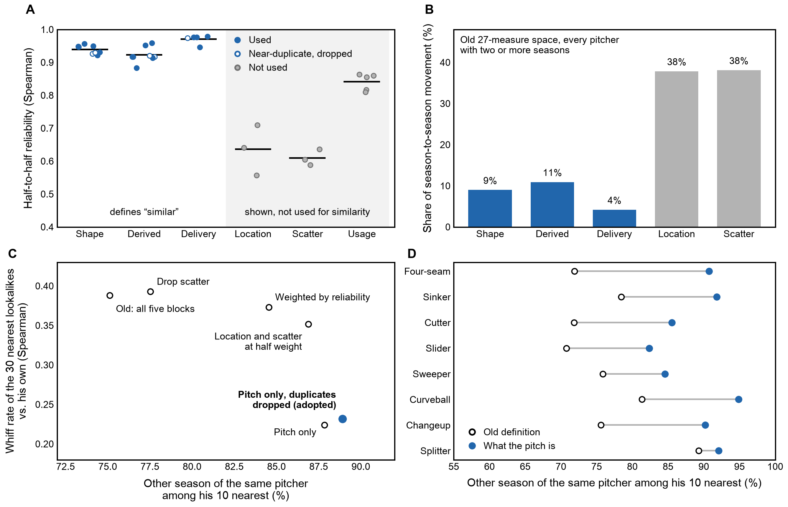

**Figure 1. "Similar" should mean what the pitch is.** (A) Half-to-half reliability of each measure: the Spearman
correlation between a pitcher's first-half and second-half value of the same pitch type (4,293 pairs), averaged
over the eight pitch types weighted by pairs. Dots are measures, horizontal lines block means. Filled blue, the 15
measures that define "similar"; open blue, near-duplicates dropped from the definition; grey, measures shown on the
atlas but not used for similarity (shaded). (B) What moved a pitcher between seasons in the old 27-measure space:
each block's share of the summed squared change between consecutive seasons of the same pitcher and pitch type,
with every block scaled to equal total variance; all pitchers with two or more seasons. (C) Six candidate
definitions of "similar", scored in the full measure space with no map involved. Horizontal, how often a pitcher's
other season of the same pitch type is among his ten nearest rows (rows that have another season). Vertical,
Spearman correlation between a pitch's whiff rate and the mean whiff rate of its 30 nearest rows thrown by other
pitchers, within pitch type, weighted by rows. Filled, the adopted definition. (D) The horizontal score of C by
pitch type, for the old definition (open) and the adopted one (filled).

**Table 1. Reliability and season-to-season movement by block** (old 27-measure space; Fig. 1A and 1B).

| Block | Measures | Half-to-half reliability | Share of season-to-season movement |
|---|---|---|---|
| Shape | velocity, spin rate, spin axis, break, accelerations | 0.94 | 9% |
| Derived | approach and release angles vs. expected, dead-zone residuals, seam-shifted wake | 0.92 | 11% |
| Delivery | arm angle, release side and height, extension | 0.97 | 4% |
| Location | horizontal and vertical location, zone rate | 0.64 | 38% |
| Scatter | release, movement and velocity scatter | 0.61 | 38% |
| Usage (comps only) | overall, ahead, behind, vs. LHB, vs. RHB | 0.82 to 0.86 | n/a (never in the map space) |

The old space gave every block equal total weight. Three noisy location columns and three noisy scatter columns
therefore counted as much as eight shape columns, and they drove three quarters of the movement (Fig. 1B). In that
space "this pitcher changed" mostly meant he located differently or was less repeatable that year.

**Table 2. Candidate definitions, scored in the full space** (Fig. 1C).

| Definition | Other season of the same pitcher among his 10 nearest | Whiff signal in the 30-neighbourhood | Location gap tracks whiff gap among lookalikes | Old top-10 lookalikes kept |
|---|---|---|---|---|
| Old: all five blocks, equal weight | 75% | 0.39 | 0.16 | 100% |
| Pitch only: shape, derived, delivery | 88% | 0.22 | 0.33 | 28% |
| **Pitch only, near-duplicates dropped (adopted)** | **89%** | **0.23** | **0.33** | **26%** |
| Drop scatter only | 78% | 0.39 | 0.15 | 52% |
| Location and scatter at half weight | 87% | 0.35 | 0.23 | 58% |
| Each block weighted by its reliability | 85% | 0.37 | 0.19 | 72% |

The adopted definition finds a pitcher's other season more often in every pitch type: by 3 points for splitters, 9
for sweepers, 12 for sliders and 13 to 19 for the other five (Fig. 1D). It uses 15 columns: velocity, spin rate, spin axis as sine and cosine,
horizontal break, induced vertical break; vertical approach and release angle against expectation, dead-zone run
and ride residuals, seam-shifted-wake deviation; arm angle, release side, release height, extension. Six columns
are dropped as near-duplicates because they correlate at 0.89 or more with another column in every pitch type
(Table F, Fig. S7): the horizontal approach and release angles, both accelerations, the velocity-conditioned
dead-zone ride and height-scaled extension. Every dropped column, together with location, scatter and usage,
still appears on the atlas's cards, heat tables, filters and colour menu. They no longer decide who looks like
whom.

The cost is outcome signal: a pitch's 30 nearest lookalikes now predict its whiff rate at 0.23 instead of 0.39
(Fig. 1C). Figure 4 shows where that signal went.

## 3. Which picture keeps that similarity (Figure 2)

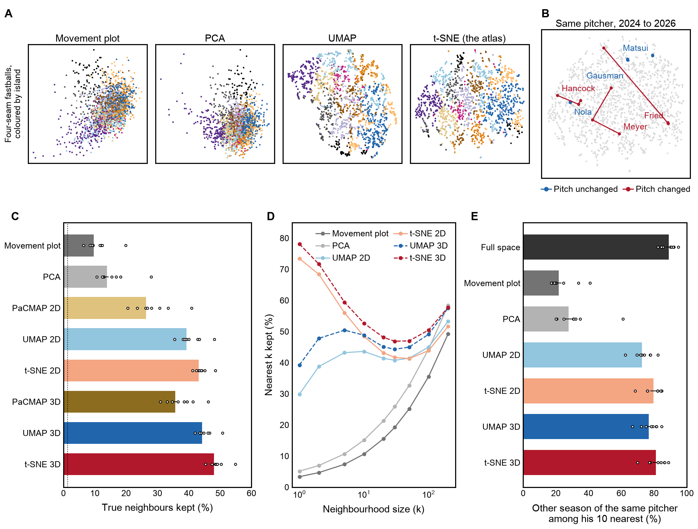

**Figure 2. t-SNE keeps the most of that similarity.** (A) The 1,850 four-seam fastballs on four 2D pictures of the
15 identity measures: the movement plot (induced vertical break against horizontal break), the first two principal
components, UMAP (10 neighbours, min_dist 0.1, the atlas's previous map) and t-SNE (perplexity 30, the atlas's map).
Colour is the pitch's Leiden island in the full 15-measure space (11 islands; colours are labels only). A picture
that keeps the full space's structure keeps each colour together. Axes have no units. (B) The atlas's t-SNE 2D
four-seam map with the three seasons of six pitchers joined in season order, named at their 2026 position. The six
were chosen on shape and delivery change, not on the map: among pitchers with three seasons of at least 150
four-seamers, the three who changed least (blue) and most (red). (C) True neighbours kept: of a pitch's ten nearest
pitches of the same type in the 15-measure space, the share that are also among its ten nearest dots, leaving out
the pitcher's own other seasons on both sides. Bars, mean over all 7,889 rows; whiskers, 95% pitcher-clustered
bootstrap intervals (1,000 draws); dots, the eight pitch types; dotted line, chance (1.3%). (D) The same score
against neighbourhood size k (1 to 200, log scale), here counting the pitcher's own other seasons as neighbours;
solid 2D, dashed 3D. (E) How often a pitcher's other season of the same pitch type is among his ten nearest dots
(rows that have another season); "Full space" is the 15 measures themselves. Bars, whiskers and dots as in C.

**What the pictures look like** (Fig. 2A). The movement plot and PCA overlay islands that the full space keeps
apart; UMAP and t-SNE separate them. Panel B is a check that
the map means something for real pitchers. The stable three stay put: path length under 1% of the map's width. The
movers changed their pitch. Hancock's arm angle fell from 29 to 10 degrees and his ride from 13.7 to 9.0 inches.
Meyer's slot went 46, 37, 44 degrees, with 220 rpm more spin and twice the arm-side run. Fried gained 5 inches of
ride and 2 mph in 2025. They travel 40% (Meyer), 18% (Hancock) and 57% (Fried) of the map.

**Table 3. True neighbours kept at k = 10** (self-free, %, 95% CI; Fig. 2C, Fig. S1A, Table A1).

| Map | 2D | 3D |
|---|---|---|
| Movement plot | 10 [9, 10] | |
| PCA | 14 [13, 14] | 25 [25, 26] |
| PHATE | 18 [17, 18] | 22 [22, 23] |
| TriMap | 28 [28, 29] | |
| PaCMAP, best grid cell | 30 [30, 31] | 39 (Table E3b) |
| densMAP | | 37 [36, 37] |
| UMAP, 15 / 0.3 | 30 [30, 31] | 41 [40, 42] |
| UMAP, 10 / 0.1 | 39 [39, 40] | 44 [44, 45] |
| **t-SNE, perplexity 30 (built)** | **43 [43, 44]** | **48 [48, 49]** |
| Random | 1 [1, 1] | |

Paired differences on the same bootstrap draws: UMAP 10 / 0.1 minus t-SNE is -4 points [-4, -3] in both 2D and 3D;
PaCMAP 3D minus t-SNE 3D is -12 [-13, -12]; the movement plot minus t-SNE 2D is -34. The ordering holds in every
pitch type (dots in Fig. 2C; Table A2) and under cosine distance as truth (Table A4). A linear picture needs about
five principal components to match t-SNE (2: 14%, 3: 25%, 4: 38%, 5: 51%; Table A3).

- **t-SNE's advantage is at the finest scale.** At k = 1 it keeps about three quarters of nearest neighbours (73%
  in 2D, 78% in 3D) against 30% and 39% for UMAP 10 / 0.1. The curves meet near k = 50 in 2D and only at k = 200 in
  3D (Fig. 2D). Co-ranking agrees: the R_NX area is 0.56 for t-SNE 3D and 0.50 for t-SNE 2D, against 0.46 and 0.40
  for UMAP 10 / 0.1 and 0.21 for the movement plot (Fig. S1C).
- **It is a property of the method, not the settings.** t-SNE is flat across perplexity (43% at 10, 30 and 50 in
  2D; 45% to 48% in 3D). Giving it UMAP's own 15-neighbour graph changes nothing (44%). No UMAP cell reaches it
  (best 41% in 2D at 10 / 0.0, 44% in 3D; Fig. S3; Tables E1, E4, E4b).
- **What t-SNE gives up is a little global shape and continuity.** Distance rank-correlation is 0.70 for t-SNE 3D
  and 0.69 for UMAP 3D, so the two are level in 3D. In 2D the figures are 0.62 and 0.64 (Fig. S1B, Fig. S2).
  Continuity is 0.94 against 0.95 in 3D. PCA 3 (0.90) and densMAP (0.88) keep global distances far better and
  local neighbourhoods far worse.
- **Island agreement is high everywhere except the old pictures.** A dot's ten map-neighbours vote for its own
  island 86% of the time on t-SNE 3D, 87% to 88% on UMAP 3D and 45% on the movement plot, against 92% in the full
  space.
- **The maps find a pitcher again** (Fig. 2E; Tables A5 and A6). The full space recovers another season of the same
  pitcher 89% of the time. t-SNE 3D does so 81%, t-SNE 2D 80%, UMAP 10 / 0.1 77% (3D) and 73% (2D), PCA 28% and the
  movement plot 22%. Every map improves with pitch count (t-SNE 3D from 75% in the lowest quartile to 87% in the
  highest), but no map pulls small samples toward its centre (|Spearman| at most 0.04).
- **No season or handedness artefact.** Different-pitcher neighbours come from the same season 30% to 33% of the
  time against 33% chance. Same-handedness is 69% in the full space and 62% to 68% on the maps, against 61% chance.
  Left-handers are mirrored, so this is a mild real difference between the populations.
- **On the all-pitches map the gap is widest** (Fig. S6; Tables G1 to G3). t-SNE keeps 45% [44, 45] of true
  neighbours in 2D and 47% in 3D, against 27% and 38% for UMAP 10 / 0.1, 16% and 29% for PaCMAP and 4% for the
  movement plot. Pitch-type purity of ten-neighbourhoods is 90.5% on t-SNE 2D, level with the full space (90.7%).

## 4. Placing new pitchers and refreshing the map (Figure 3)

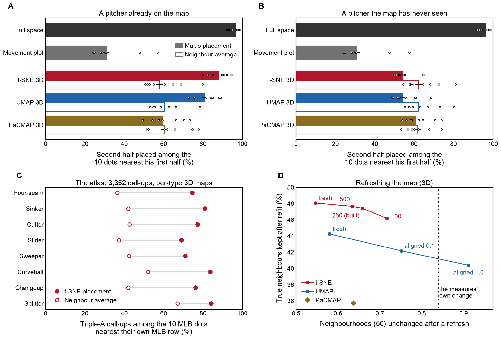

**Figure 3. New data lands beside the pitcher's own earlier row, and the map survives a refresh.** (A) A pitcher
already on the map, as in a refresh or a call-up with an MLB row. Scaling, PCA and the map are fitted on every
first-half profile, and each pitcher's second half (4,293 pairs) is placed on it. Score: the share whose own first
half is among the ten dots nearest the placed second half (chance 1.7%). Filled bars, the library's own placement
(`transform`); open bars, the inverse-distance-weighted mean map position of the 15 nearest first halves in the full
space, his own included. The full space and the movement plot need no placement. (B) A pitcher the map has never
seen: five pitcher folds; each map is fitted without the held-out pitchers and both of their halves are placed on
it; score and bars as in A. Fold-to-fold ranges are within eight points (Table B2). In A and B, whiskers are 95%
pitcher-clustered bootstrap intervals and dots are pitch types. (C) The built atlas: the 3,352 Triple-A rows whose
pitcher has an MLB row of the same pitch type, on the per-type 3D maps. Share placed among the ten MLB dots nearest
their own MLB row, for the stored t-SNE placement (filled) and the 15-neighbour average computed on the same maps
(open). (D) Refreshing the map in 3D: fit on first-half profiles, then refit on full-season profiles. Horizontal,
overlap of each dot's 50 nearest neighbours between the two fits on the common rows; vertical, true neighbours kept
(k = 10, self-free) after the refit. t-SNE: a fresh fit, and restarts from the previous layout for 500, 250 (the
atlas's setting) and 100 iterations without early exaggeration. UMAP (10, 0.1): a fresh fit, and AlignedUMAP at
regularisation 0.1 and 1.0. Diamond, PaCMAP (15), fresh fit. Dotted line, the 15 measures' own 50-neighbourhoods
are 84% the same between the two profile tables; a map to its right holds in place pitchers who really changed.
One seeded fit per pitch type, rows pooled.

**A known pitcher returns** (Fig. 3A, Table B1). The full space finds his first half among the ten nearest 96% of
the time. t-SNE's transform places his second half there 88% of the time in 3D and 83% in 2D, and makes his own
first half the single nearest dot 70% and 63% of the time. UMAP 10 / 0.1's transform manages 81% and 73%, PaCMAP
3D's 60%, the movement plot 31%. The neighbour average does much worse (58% in 3D, 33% in 2D for t-SNE), because
averaging 15 neighbours' positions blurs the one neighbour that matters, his own earlier row.

**A stranger arrives** (Fig. 3B, Table B2). Here the average wins in 3D. It scores 62% on t-SNE, UMAP and PaCMAP
alike, against 54% for the t-SNE and UMAP transforms; the movement plot scores 31%. In 2D both placements score 41%
to 50%.

**The atlas** (Fig. 3C). A call-up with an MLB row is placed by t-SNE's transform, anyone else by the neighbour
average. On the built per-type maps 76% (3D) and 69% (2D) of call-ups land among the ten MLB dots nearest their own
MLB row, against 41% and 24% for the average on the same pitchers. The gain holds in every pitch type. These numbers
came out only after fixing an openTSNE behaviour that had silently shifted every transformed point (Section 7).

**Refresh** (Fig. 3D). The atlas restarts t-SNE from the previous layout on every later build.

| Protocol, 3D | 50-neighbourhood overlap | True neighbours kept after refit |
|---|---|---|
| t-SNE, fresh fit | 0.55 | 48.1% |
| **t-SNE, restart 250 iterations (built)** | **0.66** | **47.4%** |
| t-SNE, restart 100 iterations | 0.72 | 46.2% |
| UMAP 10 / 0.1, fresh fit | 0.58 | 44.2% |
| UMAP 10 / 0.1, restart 100 epochs | 0.58 | 42.8% |
| AlignedUMAP 10 / 0.1, regularisation 0.1 | 0.75 | 42.2% |
| AlignedUMAP 10 / 0.1, regularisation 1.0 | 0.91 | 40.4% |

In 3D, AlignedUMAP at 0.1 is 0.03 more stable than a 100-iteration t-SNE restart and 4 points less accurate. In 2D
the t-SNE restart is ahead on both counts: 0.77 overlap at 39.9% against 0.74 at 35.1% (Fig. S4C). UMAP gains
nothing from a plain restart, because its optimiser moves every point far enough to erase the starting layout.
Regularisation 1.0 holds the layout beyond the 0.84 reference, which means it hides real change. The all-pitches
map behaves the same way with the 500-iteration restart (Table G3): t-SNE 0.69 in 2D and 0.62 in 3D, against UMAP's
0.48 to 0.55 and 0.65 to 0.66.

From a cold start with a new seed, UMAP reproduces itself best: 50-neighbourhood overlap 0.79 in 2D and 0.87 in 3D,
Procrustes disparity 0.02 to 0.03. t-SNE reshuffles more (0.51 and 0.70, disparity 0.24 to 0.37) and PaCMAP is in
between (0.69, 0.83). Each run is equally accurate, varying by at most one point (Fig. S4A, B). Since the atlas
never refits from a cold start after its first build, the restart numbers above are the ones that matter.

## 5. Same pitch, different location (Figure 4)

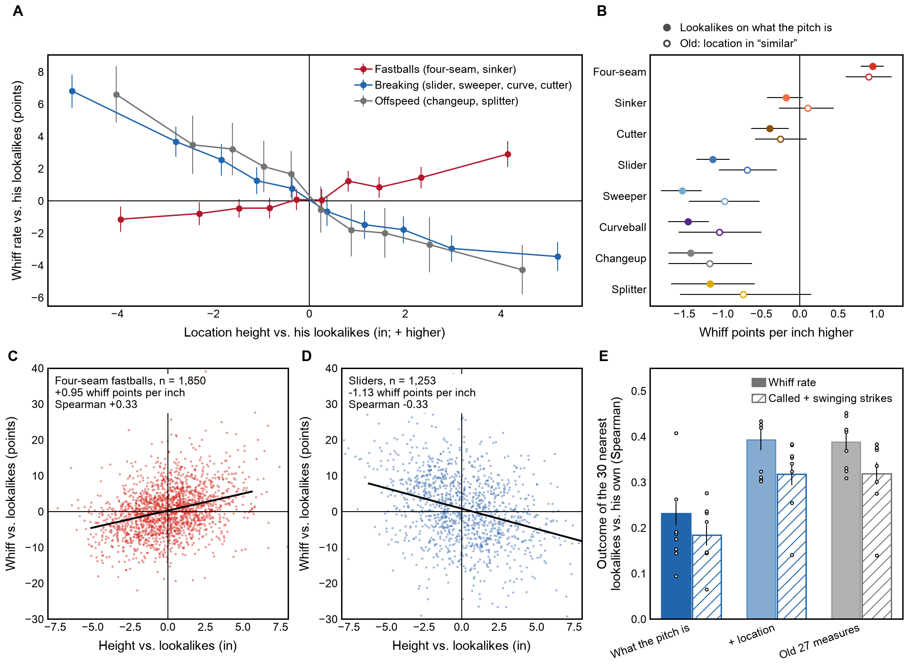

**Figure 4. Among pitches shaped alike, location height goes with whiff rate.** For every pitch, its gap to the mean
of its 30 nearest other-pitcher lookalikes (15 identity measures, same pitch type) in location height (inches;
positive, thrown higher) and in whiff rate (percentage points). (A) Mean whiff gap in deciles of the height gap,
within each family: fastballs (four-seam, sinker), breaking balls (slider, sweeper, curveball, cutter), offspeed
(changeup, splitter). Whiskers, ±1.96 standard errors of the decile mean, rows treated as independent. (B)
Least-squares slope of whiff gap on height gap by pitch type, for lookalikes on what the pitch is (filled) and for
lookalikes in the old 27-measure space, where location was part of "similar" (open). Whiskers, 95%
pitcher-clustered bootstrap intervals. (C, D) Every four-seam fastball (n = 1,850) and slider (n = 1,253), with the
least-squares line drawn between the 1st and 99th percentiles of the height gap; a few points fall outside the axes.
(E) Outcome signal in a neighbourhood: Spearman correlation between a pitch's outcome and the mean of its 30 nearest
other-pitcher lookalikes, within pitch type, weighted by rows, for three definitions of lookalike: what the pitch is
(the atlas's 15 measures), the same with the three location measures added, and the old 27 measures. Solid, whiff
rate; hatched, called plus swinging strikes (CSW). Whiskers, 95% pitcher-clustered bootstrap intervals; dots, pitch
types.

Holding the pitch fixed separates what the pitch is from where it is thrown, and the second matters a great deal.

**Table 4. Location height against results among identity lookalikes** (Fig. 4B to 4D; Table L1).

| Pitch type | Height gap vs. whiff gap (Spearman) | 95% CI | Old space | Whiff points per inch higher | Zone-rate gap vs. CSW gap |
|---|---|---|---|---|---|
| Four-seam | +0.33 | [0.29, 0.38] | +0.16 | +0.95 | +0.36 |
| Sinker | -0.07 | [-0.14, -0.01] | +0.03 | -0.18 | +0.39 |
| Cutter | -0.11 | [-0.20, -0.02] | -0.05 | -0.39 | +0.30 |
| Slider | -0.33 | [-0.39, -0.27] | -0.11 | -1.13 | +0.17 |
| Sweeper | -0.41 | [-0.47, -0.34] | -0.17 | -1.53 | +0.29 |
| Curveball | -0.41 | [-0.47, -0.35] | -0.16 | -1.45 | +0.35 |
| Changeup | -0.33 | [-0.39, -0.27] | -0.15 | -1.42 | +0.27 |
| Splitter | -0.32 | [-0.44, -0.18] | -0.15 | -1.17 | +0.21 |

- **The direction is what a pitching coach would expect, and the size is not small.** A four-seamer thrown 2.3
  inches higher than its lookalikes, one standard deviation of the height gap, gets about two more points of whiff
  rate. A sweeper or curveball thrown 2.5 to 2.9 inches lower gets about four more. Sinkers and cutters depend on
  height far less (Fig. 4A, 4B).
- **Leaving location out of "similar" is what makes this visible.** In the old space lookalikes were matched partly
  on location, so the comparison was between pitches thrown at similar heights. The relation there is half as
  strong in every type (open dots in Fig. 4B). Movement-plot neighbours, which also ignore location, show the same
  strength as the identity space (Table L1). The point is about leaving location out, not about the particular
  measures.
- **Location carries much of a neighbourhood's outcome signal.** Adding the three location measures back to the
  definition raises the whiff correlation from 0.23 to 0.39 and CSW from 0.18 to 0.32, level with the old 27
  measures (Fig. 4E). Every map keeps about two thirds of the identity space's signal: t-SNE 3D 0.17, UMAP 3D 0.17,
  PaCMAP 3D 0.18, the movement plot 0.08 (Fig. S5). A season outcome is noisy, which bounds any predictor: by
  Spearman-Brown from the half-to-half correlations, a season value's correlation with anything is bounded by about
  0.80 for whiff, 0.77 for CSW, 0.64 for xwOBA on contact and 0.42 for raw run value (Table C1). These
  neighbourhood means explain little variance (R² 0.05 for whiff) and the atlas uses them to describe, not to
  forecast.
- **Height is the location that matters.** Horizontal location gaps barely relate to whiff gaps (|Spearman| at most
  0.14). Zone-rate gaps go with CSW gaps (0.17 to 0.39), as they must, since a called strike needs the zone.
- **Command, as release scatter, does not.** A pitcher whose release point varies more than his lookalikes' does not
  get fewer whiffs (|Spearman| at most 0.14, and within 0.06 of zero in seven of eight types).
- **The atlas map keeps the relation.** On the t-SNE 3D map's own neighbourhoods the correlations match the full
  space within 0.03 (Table L1).

On the atlas, every card now carries a "Same pitch, different location" box. It sets the pitcher's location, zone
rate and whiff rate against his lookalikes, then splits those lookalikes at their median height to show what height
has been worth for pitches shaped like his. The three gaps are also measures to filter and colour the map by. These
are descriptive scouting reads, not causal estimates. Pitcher quality, counts, batter handedness and arsenal context
are not held equal. A pitcher may locate higher because he is ahead in counts more often, or because his other
pitches make it work.

## 6. Methods

### 6.1 Maps compared

| Map | Library (version) | Settings tested | Out-of-sample | 3D |
|---|---|---|---|---|
| Movement plot | none | induced vertical break x horizontal break, z-scored | trivial | no |
| Savant-5 | none | velocity, break (2), release height, extension: PCA to 2D, and the raw 5-D space | trivial | no |
| PCA | scikit-learn 1.9.0 | 2 and 3 components | trivial | yes |
| Isomap, TriMap | scikit-learn, trimap 1.2.0 | 15 neighbours / defaults, 2D | no | no |
| PHATE | phate 2.0.0 | knn 15, 2D and 3D | kernel extension | yes |
| PaCMAP, LocalMAP | pacmap 0.9.1 | n_neighbors 10 / 15 / 30, MN ratio 0.5 / 1.0; 3D grid | `transform` | yes |
| UMAP, densMAP, AlignedUMAP | umap-learn 0.5.12 | 2D grid n_neighbors 5-50 x min_dist 0.0-0.5; 3D grid; spectral and PCA init; restarts; alignment 0.01 / 0.1 / 1.0 | `transform` | yes |
| **t-SNE (built)** | openTSNE 1.0.4 | **perplexity 30, PCA init, Barnes-Hut**; perplexity 10 / 50; exaggeration 2 / 4; uniform k = 15 affinities; restarts at 100 / 250 / 500 iterations | `transform` | yes |

UMAP at 10 neighbours, min_dist 0.1 was the atlas's map from the morning of 2026-11-04 until version 3. It appears
throughout as the strongest UMAP. Fits of up to 1,850 rows take seconds on one core. The all-pitches map of 7,889
rows takes 39 s (2D) and 63 s (3D) with t-SNE.

### 6.2 Scores

**Truth.** A pitch's true neighbours are its ten nearest pitches of the same type on the 15 identity measures,
z-scored within type, each block given equal total weight. **Self-free** scores leave out the same pitcher's other
seasons on both sides. They are the headline: the nearest true neighbour is the pitcher's own other season for 53%
of rows.

- **True neighbours kept (recall@k):** of a pitch's k truly nearest, the share that are also its k nearest dots.
  Chance is 1.3% at k = 10.
- **Trustworthiness and continuity:** the first falls when dots sit together that are not close in truth, the second
  when truly close pitches are torn apart.
- **Co-ranking** (Lee and Verleysen): the share of K-neighbourhoods preserved at every scale K, summarised as the
  log-weighted R_NX area and the scale K_max where a map's advantage over a random layout peaks.
- **Distance rank-correlation:** Spearman correlation of true and map distances over 50,000 fixed random pairs, a
  global-structure score.
- **Island agreement:** how often a dot's ten map-neighbours vote for its own full-space Leiden island (6 to 11 per
  type).
- **Same pitcher, other season:** whether any of his other seasons is among his ten nearest dots.
- **Outcome signal:** Spearman correlation, within type, between a pitch's outcome and the mean outcome of its k
  nearest dots thrown by other pitchers. Outcomes are never features.

### 6.3 Uncertainty

Intervals are 95% percentile bootstraps over pitchers (all of a pitcher's rows move together), 1,000 draws, shared
by every map, so paired differences are honest. Stability and settings results are single seeded fits per type;
their figures show the per-type spread. "Weighted" pools rows across types, so four-seamers are 23% of every
weighted score. Full tables with intervals: [umap_benchmark/tables.md](umap_benchmark/tables.md).

### 6.4 Figures

Figures follow `figure_aesthetics/cell_figure_guidelines.md` through `scripts/figure_style.py` and
`figure_aesthetics/cell_typography.py`: 174 mm wide at print, text 6 to 8 pt, strokes 0.5 to 1.5 pt, capital
panel letters, no red with green, individual points (pitch types) beside every mean, titles and legends here rather
than in the image. Each figure is saved as a PDF with fonts embedded (production) and a 300-dpi PNG (review).
Arial is not installed on the cluster; the figures use Arial Unicode MS, which shares Arial's letterforms, and on a
machine with Arial the same script uses Arial.

## 7. What the atlas does now

Built and deployed on 2026-11-04 (Space commits 1ce5d41 and d4d181b):

- **Maps:** openTSNE, perplexity 30, PCA initialisation, 2D and 3D, all-pitches and one per type, on the 15 identity
  measures (`profile_embed.IDENTITY_BLOCKS`). A later build restarts each map from the previous layout for 250
  iterations if the cached layout used the same measures (`data/meta/atlas_layout_2024_2026.json`). Otherwise it
  fits from scratch. `--cold-layout` forces a fresh fit.
- **Lookalikes, uniqueness, Leiden islands and group regions** use the same 15 measures. About 31% of the old top-ten
  lookalike lists survived the change.
- **Triple-A placement:** a call-up who has an MLB row of the same pitch type is placed with the map's t-SNE
  transform, and anyone else with the 15-neighbour average. Of 6,898 Triple-A rows, 3,352 are call-ups (Fig. 3C).
- **A bug worth knowing about.** openTSNE's `transform` re-centres the fitted embedding in place the first time it is
  called. Any coordinates saved before that call no longer share a frame with the transformed points, and in the
  first build this left four-seamer call-ups 14% on target instead of 75%. The shift is a pure translation.
  `atlas_core.tsne_place` measures it and moves transformed points back into the saved frame.
- **On the page:** the "Same pitch, different location" box on every card; three new measures (whiff, location height
  and zone rate against lookalikes) in the filters and colour menu; help, glossary and source text that say what
  lookalikes are matched on.

Open:

- **Fit labels.** "Close", "Loose" and "Very loose" rank a lookalike against the best-match distances of all pitch
  types pooled, while the tooltip says the same type. Splitters get "Very loose" for 57% of their lookalikes and
  four-seamers for 18%. Ranking within type would make the labels mean what the tooltip says.
- **Location as a pitcher trait.** The location box is per pitch. Whether some pitchers consistently locate better
  than their lookalikes across pitch types and seasons is a natural next question, and the per-pitch gaps already
  computed are the data for it.

## 8. Claims and evidence

| Claim | Evidence | Status |
|---|---|---|
| Location and scatter should not define "similar" | Fig. 1, Table 1: reliability 0.6 against 0.92 to 0.97; 76% of season-to-season movement; Table 2: same-pitcher recovery 89% against 75% | supported; a design choice, made by the atlas's author |
| t-SNE is the most faithful map of the identity measures | Fig. 2C, 2D, S1, S3; Tables A1, A2, E1, E4: +4 points over the best UMAP in 2D and 3D, intervals ±0.5; all-pitches map +18 (2D, Fig. S6) | supported; the gap is largest for the very nearest neighbours |
| t-SNE's transform places a returning pitcher best | Fig. 3A, Table B1: 88% (3D) against 81% UMAP transform and 58% averaging; built atlas 76% (3D) and 69% (2D) after the frame fix (Fig. 3C) | supported |
| The average places a stranger best in 3D | Fig. 3B, Table B2: 62% against 54% | supported |
| t-SNE restarted from the previous layout is as stable as AlignedUMAP | Fig. 3D, S4C: 3D 0.72 at 46.2% against 0.75 at 42.2%; 2D 0.77 at 39.9% against 0.74 at 35.1% | supported within 0.03 overlap; single fits |
| Among identity lookalikes, height tracks whiff, in the expected direction | Fig. 4, Table 4: +0.33 four-seam, -0.32 to -0.41 breaking and offspeed, intervals clear of zero; half as strong when location is part of "similar" | supported as description; not causal |
| Release scatter does not track whiff among lookalikes | Table L1: within 0.06 of zero in seven of eight types | supported for whiff; walks and other outcomes not tested |
| Neighbourhoods carry descriptive outcome signal | Fig. 4E, S5: whiff 0.23 (identity), 0.39 with location, against a bound of 0.80 | supported as description |
| No map replaces the full space | Fig. 2C, 2E, 3A, 3B; Tables A1, B1, B2 | supported |

## 9. Limitations

- The truth is the atlas's own measure space, so Figure 2, Figure 3D and Figures S1 to S4 measure faithfulness to
  that space. The same-pitcher, outcome and location tests reach outside it, and the last two are confounded by
  pitcher quality, count usage, batter handedness and arsenal context.
- Which measures define "similar" is a judgement, informed by reliability and season-to-season movement but not
  dictated by them. A team that wants lookalikes in how a pitch is used would add usage and location back; Table 2
  shows what that costs and buys.
- Rows are not independent. Intervals are clustered by pitcher and self-matches are removed from the headline, but
  four-seamers are 23% of every weighted number. The decile whiskers in Fig. 4A treat rows as independent; the
  per-type intervals in Fig. 4B and Table 4 do not.
- The refresh test compares first-half with full-season profiles, a larger change than a real refresh, so its
  overlaps are lower bounds.
- openTSNE's 3D Barnes-Hut path is marked by its authors as less tested. Its 3D results here are consistent with 2D,
  and the re-centring behaviour above was found and corrected, but no second implementation was compared.
- Grids for PaCMAP and t-SNE (3 to 9 cells) are smaller than UMAP's (20 in 2D, 12 in 3D). Parametric UMAP was not
  run.

## 10. Reproducibility

```bash
sbatch scripts/umap_benchmark.sbatch                 # per-type sections and the all-pitches map (8 CPUs, ~30 min)
python scripts/umap_benchmark.py --addenda           # restarts, AlignedUMAP, extra held-out runs, 3D grids (~7 min)
python scripts/umap_benchmark_figures.py             # tables.md with bootstrap intervals; Figures 1-4 and S1-S7
python scripts/atlas_core.py --cold-layout           # the maps, placements and comps, fresh layouts
```

Figures are drawn by `scripts/umap_benchmark_plots.py`, which caches the data behind Figures 1 to 3 as
`analysis/umap_benchmark/F*.csv` (delete them to recompute). Inputs are the season and half-season type profiles
(`data/meta/profiles_type_season_2024_2026.parquet` and its half-season twin) and, for Fig. 3C, the built atlas
table. Software: openTSNE 1.0.4, umap-learn 0.5.12, pacmap 0.9.1, phate 2.0.0, trimap 1.2.0, scikit-learn 1.9.0.
Every fit is seeded (seed 0 unless seeds are the test) and single-threaded. SLURM jobs: 13736586 (benchmark v3),
13736470 (atlas build).

## Supplementary figures

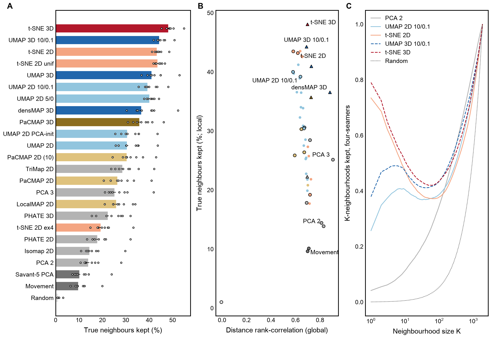

**Figure S1. Every method tested, related to Figure 2.** (A) True neighbours kept at k = 10 (self-free, as in
Fig. 2C) for every map and setting, sorted. Settings: UMAP "10/0.1" and "5/0" are n_neighbors / min_dist, unmarked
UMAP is 15 / 0.3, "PCA-init" uses PCA initialisation; t-SNE "unif" uses uniform 15-neighbour affinities, "ex4"
exaggeration 4; PaCMAP "(10)" is 10 neighbours, unmarked 15; Savant-5 PCA is velocity, both breaks, release height
and extension reduced to two components; Random is a uniform random layout. Whiskers, 95% pitcher-clustered
bootstrap intervals; dots, pitch types. (B) Local against global: true neighbours kept against distance
rank-correlation (Spearman over 50,000 fixed random pairs per type), weighted by rows. Large markers are the maps in
A (circles 2D, triangles 3D); small dots are the 2D tuning grids of UMAP, PaCMAP and t-SNE. (C) Co-ranking: the
share of K-neighbourhoods kept at every scale K for four-seam fastballs, counting a pitcher's own other seasons;
dotted, a random layout.

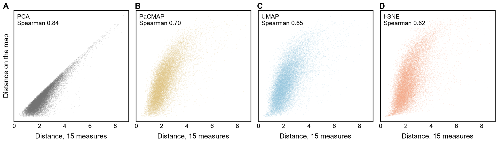

**Figure S2. Shepard diagrams, four-seam fastballs, related to Figure 2.** Distance in the scaled 15-measure space
against distance on the 2D map for 20,000 random pairs of the 1,850 four-seamers, with each map's Spearman
rank-correlation. PCA is a projection, so map distance never exceeds true distance. The neighbour-graph maps
compress long distances and spread short ones. Map distances have no units.

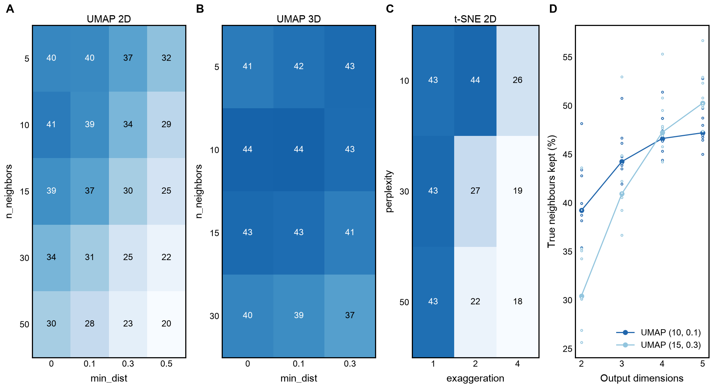

**Figure S3. Settings, related to Figure 2.** True neighbours kept at k = 10 (self-free, %, rows pooled over types;
one shared colour scale, 20% to 50%). (A) UMAP 2D over n_neighbors and min_dist. (B) UMAP 3D. (C) t-SNE 2D over
perplexity and exaggeration. (D) Output dimensions 2 to 5 for UMAP at (10, 0.1) and (15, 0.3); large dots, rows
pooled; small dots, pitch types. UMAP trades local accuracy for global shape monotonically in 2D: 41% at (10, 0.0)
to 20% at (50, 0.5). In 3D the surface is flat at 43% to 44% for 5 to 15 neighbours. t-SNE is flat in perplexity
and steep in exaggeration. Output dimension helps every method. The settings were chosen on these in-sample scores;
the held-out tests of Figure 3, which were not used to choose them, give the same ordering.

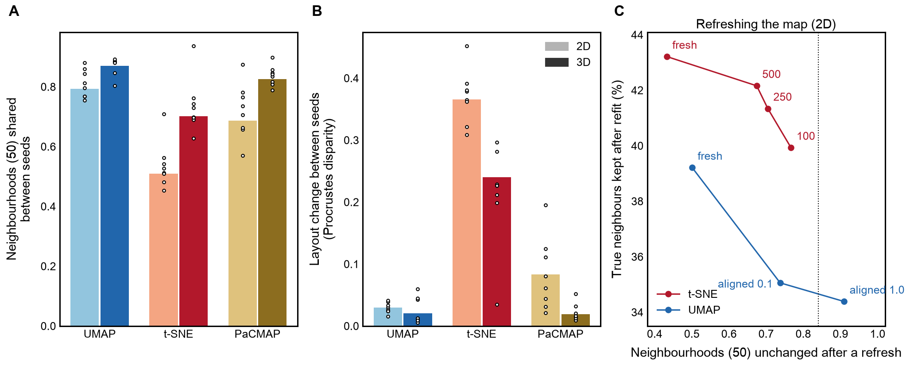

**Figure S4. Seeds and the 2D refresh, related to Figure 3.** (A, B) Five seeds per method and dimension, fresh fits:
mean overlap of each dot's 50 nearest neighbours between runs (A) and mean Procrustes disparity (B). Light 2D, dark
3D; UMAP at (10, 0.1), t-SNE at perplexity 30, PaCMAP at 15 neighbours; dots, pitch types. (C) The 2D version of
Figure 3D: t-SNE fresh and restarted for 500, 250 and 100 iterations, UMAP fresh and aligned at 0.1 and 1.0. Dotted
line, the 15 measures' own 50-neighbourhood overlap between the two profile tables (0.84).

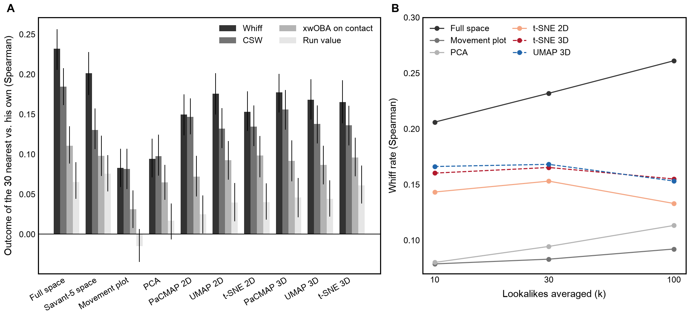

**Figure S5. Outcome signal on every picture, related to Figure 4.** (A) Spearman correlation between a pitch's
outcome and the mean of its 30 nearest dots thrown by other pitchers, within pitch type, weighted by rows, for whiff
rate, CSW, xwOBA on contact and raw run value per 100 pitches. "Full space" is the 15 measures; "Savant-5 space" the
raw five Savant measures. Whiskers, 95% pitcher-clustered bootstrap intervals. (B) Whiff rate signal against the
number of lookalikes averaged (k = 10, 30, 100); solid 2D or spaces, dashed 3D.

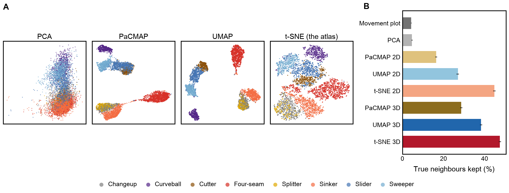

**Figure S6. The all-pitches map, related to Figure 2.** (A) All 7,889 rows on one 2D map per method, measures
z-scored over all rows, coloured by pitch type. Every map, like the full space, keeps changeups and splitters
together. UMAP and PaCMAP attach cutters to the slider island and bridge sinkers to four-seamers; t-SNE gives each
type its own island; PCA overlays everything. (B) True neighbours kept at k = 10 (truth is the ten nearest rows of
any type in the globally scaled 15-measure space; the same pitcher's other seasons of the same type left out). Whiskers, 95% pitcher-clustered bootstrap
intervals.

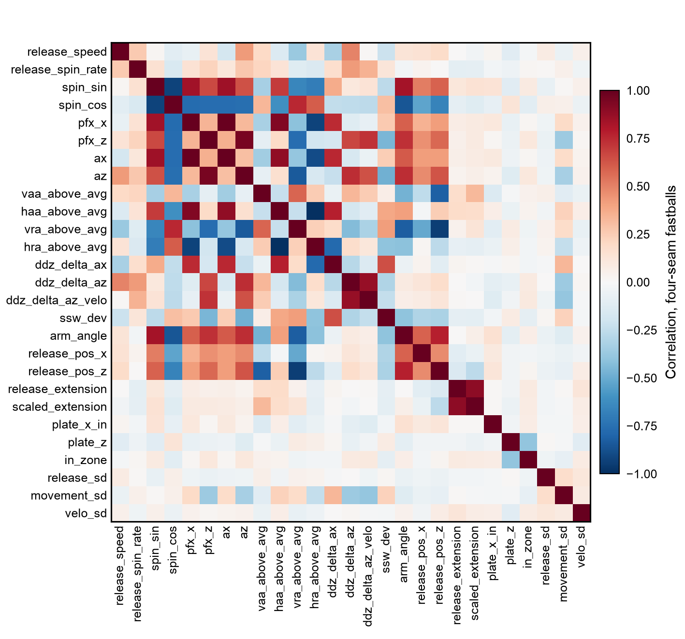

**Figure S7. Correlations among the 27 measures of the old space, four-seam fastballs, related to Figure 1.**
Pearson correlation over the 1,850 four-seam rows. The dark off-diagonal pairs are the near-duplicates dropped from
the identity measures: horizontal break with both horizontal angles and horizontal acceleration, vertical break with
vertical acceleration, the two dead-zone ride residuals, and the two extension measures. The location and scatter
measures, now outside the definition of "similar", are nearly independent of the rest.
