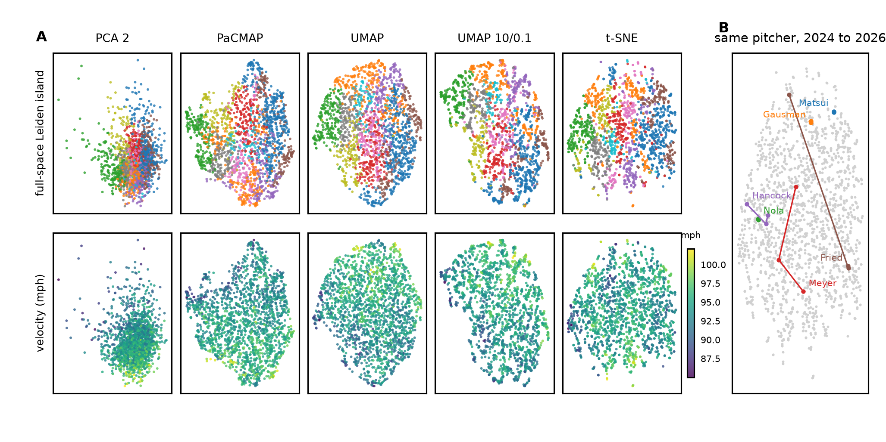
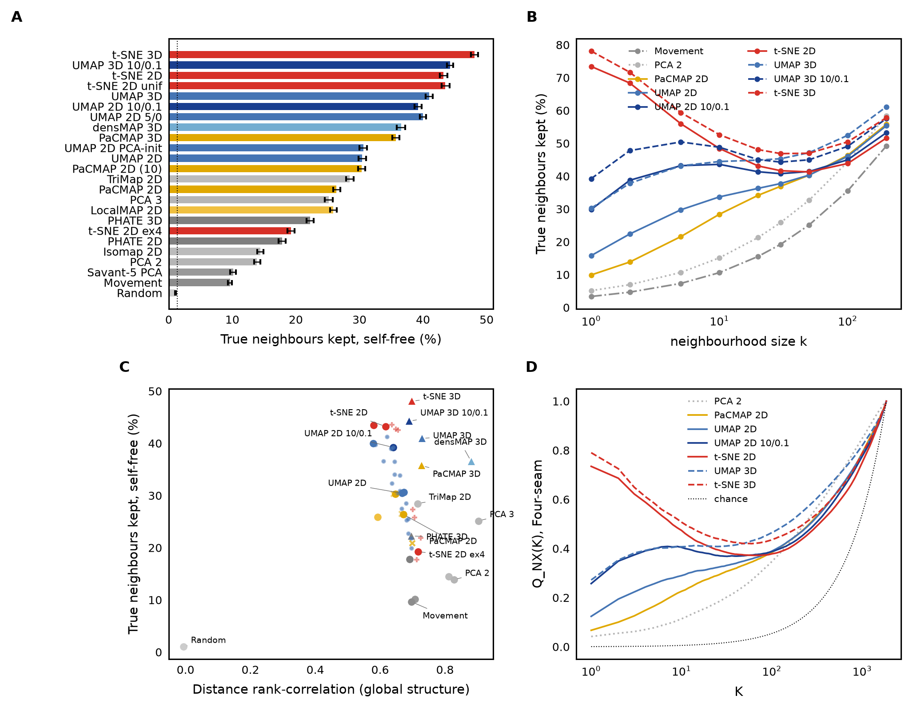
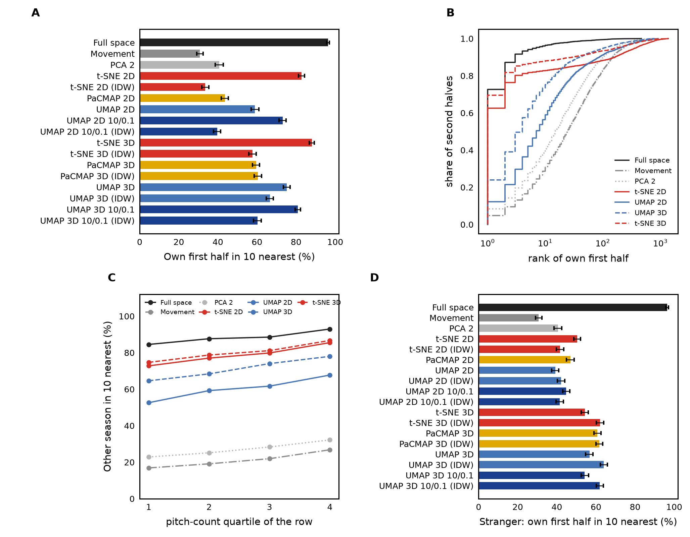
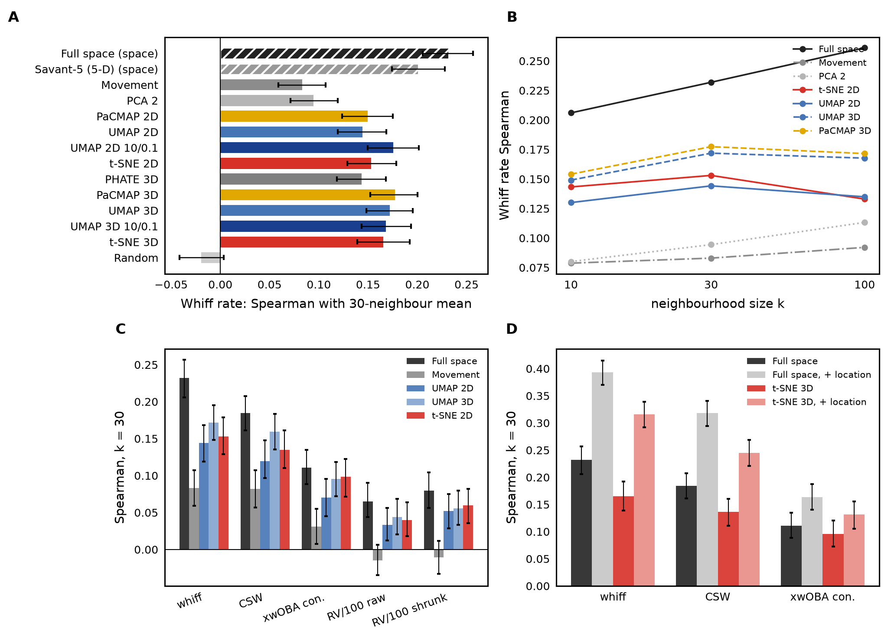
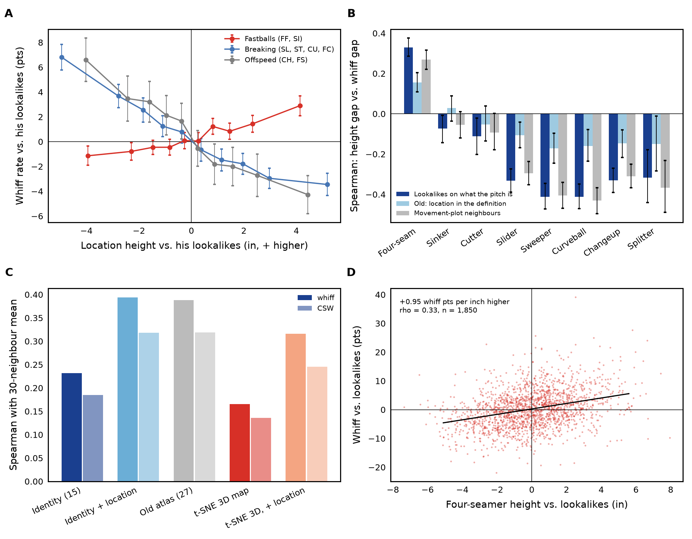
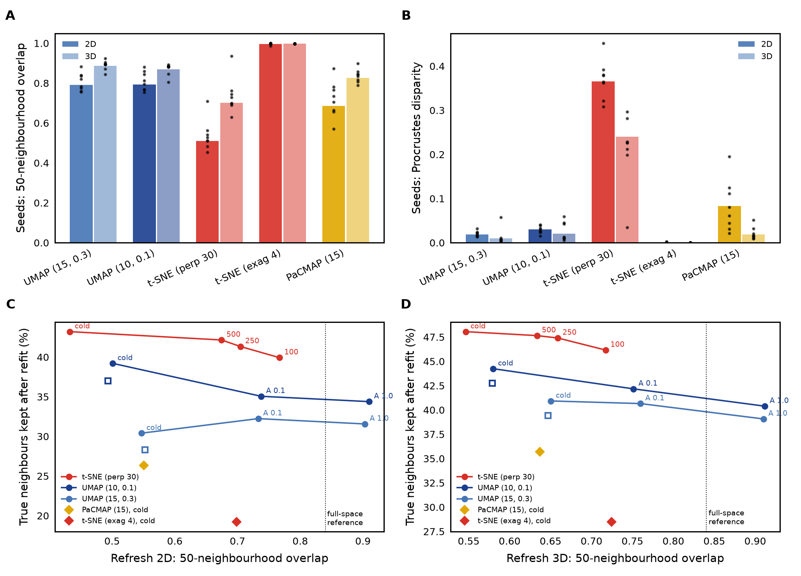
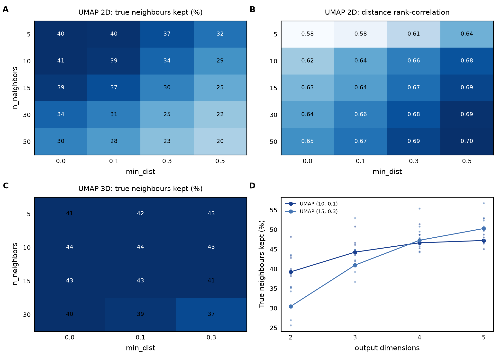
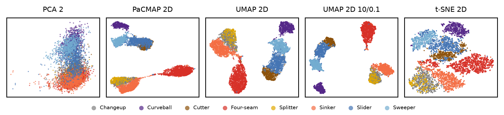
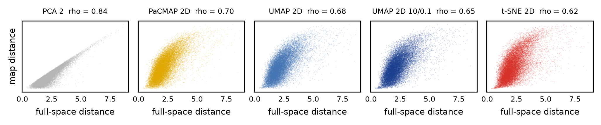
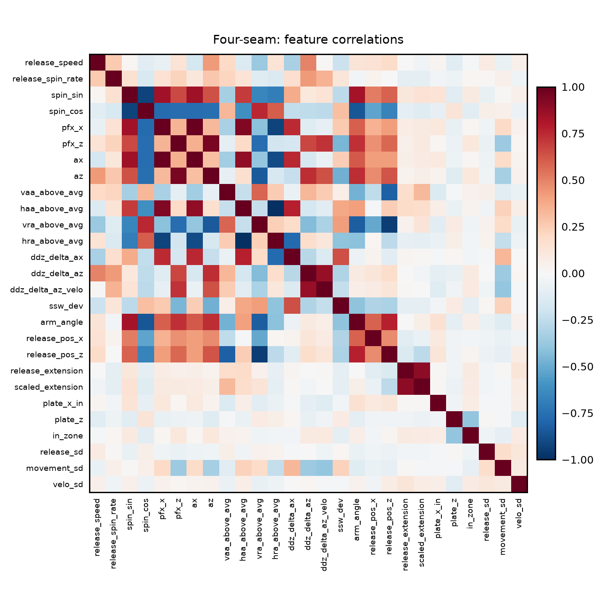

# What makes two pitches alike, and how to draw it: a benchmark for the Pitch Universe atlas

*Version 3, 2026-11-04. Supersedes the 2026-10-31 note (`umap_justification.md`) and versions 1 to 2.2 of this
document. Versions 1 to 2.2 compared maps of the atlas's old 27-measure space and went through three rounds of
independent review (statistics, dimensionality reduction, baseball analytics). Version 3 follows the two decisions
those results led to. "Similar" now means similar in what the pitch is: shape, angles and delivery, 15 measures.
The atlas is now drawn with t-SNE. Every number below was recomputed on that definition (SLURM job 13736586).*

## Summary

The Pitch Universe atlas draws one dot per pitcher-season-pitch-type and lists, for every pitch, its ten
lookalikes. Two questions decide whether those dots and lists mean anything. What should "similar" mean? And
which picture shows that similarity most faithfully? This study answers both on the 2024 to 2026 MLB data:
7,889 dots, eight pitch types.

1. **Similar should mean what the pitch is, not where it is thrown or how repeatably.** Shape, angles and
   delivery measures repeat from a pitcher's first half to his second at 0.92 to 0.97. Location and release or
   movement scatter repeat at about 0.6 (Table 1). In the atlas's old 27-measure space, those two noisy blocks
   caused 76% of a pitcher's season-to-season movement. On the 15 identity measures, a pitcher's other
   season is among his ten nearest pitches 89% of the time, against 75% before (Table A5). The atlas now uses
   these measures for its maps, lookalikes, uniqueness and group regions.

2. **Same pitch, different location.** Among lookalikes matched on what the pitch is, the gap in location
   height tracks the gap in whiff rate (Fig. 8, Table L1). Four-seamers thrown higher than their lookalikes
   get more whiffs: Spearman +0.33, about one point of whiff rate per inch. Sliders, sweepers, curveballs,
   changeups and splitters thrown lower get more: -0.32 to -0.41, 1.1 to 1.5 points per inch. Sinkers and
   cutters show little. The relation is about twice as strong as when location was part of "similar", because
   the old definition matched pitches on location and so hid its effect. Horizontal location and release
   scatter explain nothing comparable. Location also carries a large share of the outcome signal in a
   neighbourhood: adding it back raises the whiff correlation from 0.23 to 0.39.

3. **t-SNE draws that similarity most faithfully.** It keeps 48% of a pitch's ten truly nearest pitches in 3D
   and 43% in 2D. UMAP, at the settings the atlas used until today, keeps 44% and 39%. PaCMAP keeps 36% in 3D,
   two-axis PCA 14% and the Savant-style movement plot 10% (Fig. 2, Table A1). The gap to UMAP is four points
   in both dimensions, with intervals of half a point, and no UMAP setting in a 20-cell grid closes it. On the
   all-pitches map the gap is wider: 45% against 27% in 2D (Fig. 7).

4. **New pitchers land where they belong.** For a pitcher whose earlier data is already on the map, which
   covers a call-up with an MLB row and a refresh, t-SNE's own placement puts his new data among the ten
   dots nearest his old row 88% of the time in 3D. Averaging his nearest neighbours' positions manages 58%
   (Fig. 3A). For a stranger the average is better: 62% against 54%. The atlas now uses each where it wins.
   In the rebuilt atlas, 69% to 76% of Triple-A call-ups land among the ten dots nearest their own MLB row.
   That number came out only after fixing an openTSNE behaviour that had silently shifted every transformed
   point (Section 6).

5. **Stability is comparable once refits start from the previous layout.** From scratch, UMAP reproduces
   itself across seeds better than t-SNE: 0.87 against 0.70 overlap of 50-neighbourhoods in 3D. On a real
   refresh, restarting t-SNE from the previous layout gives about the same stability as AlignedUMAP and keeps
   4 to 5 more points of true neighbours (Fig. 5).

6. **No picture replaces the full space.** The best map keeps half of each pitch's true neighbours. Lookalikes,
   uniqueness and rankings are computed on the 15 measures directly, never from map distance.

## 1. What "similar" should mean

### 1.1 Data

One row is one pitcher's version of one pitch type in one season, built from at least 40 pitches
(`mlbpitch.profiles`): 7,889 rows over 2024 to 2026 (four-seam 1,850; slider 1,253; sinker 1,235; changeup
1,021; curveball 789; sweeper 742; cutter 722; splitter 277). A second table splits each season at the All-Star
break (11,799 half-rows) and feeds the reliability, held-out and refresh tests. Left-handers are mirrored in
every lateral measure, and per-row means are shrunk toward the league mean for the pitch type.

### 1.2 Which measures repeat

Each measure's half-to-half reliability is the Spearman correlation between a pitcher's first-half and
second-half value of the same pitch type, weighted over types.

**Table 1. Reliability and season-to-season movement by block** (old 27-measure space).

| Block | Measures | Half-to-half reliability | Share of season-to-season movement |
|---|---|---|---|
| Shape | velocity, spin rate, spin axis, break, accelerations | 0.94 | 9% |
| Derived | approach and release angles vs. expected, dead-zone residuals, seam-shifted wake | 0.92 | 11% |
| Delivery | arm angle, release side and height, extension | 0.97 | 4% |
| Intent | horizontal and vertical location, zone rate | 0.64 | 38% |
| Consistency | release, movement and velocity scatter | 0.61 | 38% |
| Usage (comps only) | overall, ahead, behind, vs. LHB, vs. RHB | 0.82 to 0.86 | 14% of the comps space |

The old space gave every block equal total weight. The three noisy intent columns and three noisy scatter
columns therefore counted as much as eight shape columns, and they drove three quarters of the movement. In
that space "this pitcher changed" mostly meant he located differently or was less repeatable that year.

### 1.3 Six candidate definitions

**Table 2. Candidate definitions, scored in the full space** (no maps involved).

| Definition | Other season of the same pitcher among his 10 nearest | Whiff signal in the 30-neighbourhood | Location gap tracks whiff gap among lookalikes | Old top-10 lookalikes kept |
|---|---|---|---|---|
| Old: all five blocks, equal weight | 75% | 0.39 | 0.16 | 100% |
| Pitch only: shape, derived, delivery | 88% | 0.22 | 0.33 | 28% |
| **Pitch only, near-duplicates dropped (adopted)** | **89%** | **0.23** | **0.33** | **26%** |
| Drop scatter only | 78% | 0.39 | 0.15 | 52% |
| Location and scatter at half weight | 87% | 0.35 | 0.23 | 58% |
| Each block weighted by its reliability | 85% | 0.37 | 0.19 | 72% |

The adopted definition uses 15 columns: velocity, spin rate, spin axis as sine and cosine, horizontal break,
induced vertical break; vertical approach and release angle against expectation, dead-zone run and ride
residuals, seam-shifted-wake deviation; arm angle, release side, release height, extension. Six columns are
dropped as near-duplicates because they correlate at 0.89 or more with another column in every pitch type
(Table F, Fig. S2). These are the horizontal approach and release angles, both accelerations, the
velocity-conditioned dead-zone ride and height-scaled extension. Every dropped column, together with
location, scatter and usage, still appears on the atlas's cards, heat tables, filters and colour menu. They
just no longer decide who looks like whom. The cost is outcome signal: a pitch's 30 nearest lookalikes now
predict its whiff rate at 0.23 instead of 0.39. Section 4.5 shows where that signal went.

## 2. Maps compared

| Map | Library (version) | Settings tested | Out-of-sample | 3D |
|---|---|---|---|---|
| Movement plot | none | induced vertical break x horizontal break, z-scored | trivial | no |
| Savant-5 | none | velocity, break (2), release height, extension: PCA to 2D, and the raw 5-D space | trivial | no |
| PCA | scikit-learn 1.9.0 | 2 and 3 components | trivial | yes |
| Isomap, TriMap | scikit-learn, trimap 1.2.0 | 15 neighbours / defaults, 2D | no | no |
| PHATE | phate 2.0.0 | knn 15, 2D and 3D | kernel extension | yes |
| PaCMAP, LocalMAP | pacmap 0.9.1 | n_neighbors 10 / 15 / 30, MN ratio 0.5 / 1.0; 3D grid | `transform` | yes |
| UMAP, densMAP, AlignedUMAP | umap-learn 0.5.12 | 2D grid n_neighbors 5-50 x min_dist 0.0-0.5; 3D grid; spectral and PCA init; restarts; alignment 0.01 / 0.1 / 1.0 | `transform` | yes |
| **t-SNE (built)** | openTSNE 1.0.4 | **perplexity 30, PCA init, Barnes-Hut**; perplexity 10 / 50; exaggeration 2 / 4; uniform k = 15 affinities; restarts at 100 / 250 / 500 iterations | `transform` | yes |

UMAP at 10 neighbours, min_dist 0.1 was the atlas's map from the morning of 2026-11-04 until this version. It
appears throughout as the strongest UMAP. Fits of up to 1,850 rows take seconds on one core. The all-pitches
map of 7,889 rows takes 39 s (2D) and 63 s (3D) with t-SNE.

## 3. How the maps are scored

**Truth.** A pitch's true neighbours are its ten nearest pitches of the same type on the 15 identity measures,
z-scored within type, each block given equal total weight. **Self-free** scores leave out the same pitcher's
other seasons on both sides. They are the headline: the nearest true neighbour is the pitcher's own other
season for 53% of rows.

- **True neighbours kept (recall@k):** of a pitch's k truly nearest, the share that are also its k nearest dots.
  Chance is 1.3% at k = 10.
- **Trustworthiness and continuity:** the first falls when dots sit together that are not close in truth. The
  second falls when truly close pitches are torn apart.
- **Co-ranking** (Lee and Verleysen): the share of K-neighbourhoods preserved at every scale K, summarised as the
  log-weighted R_NX area and the scale K_max where a map's advantage over a random layout peaks.
- **Distance rank-correlation:** Spearman correlation of true and map distances over 50,000 fixed random pairs,
  a global-structure score (Fig. S1).
- **Island agreement:** how often a dot's ten map-neighbours vote for its own full-space Leiden island (6 to 11
  per type).
- **Same pitcher, other season:** whether any of his other seasons is among his ten nearest dots.

**Uncertainty.** Intervals are 95% percentile bootstraps over pitchers (all of a pitcher's rows move
together), 1,000 draws, shared by every map, so paired differences are honest. Stability and settings tables
are single seeded fits per type; their figures show the per-type spread. "Weighted" pools rows across types,
so four-seamers are 23% of every weighted score. Full tables:
[umap_benchmark/tables.md](umap_benchmark/tables.md).

## 4. Results

### 4.1 What the maps look like



**Figure 1. Four-seam fastballs (n = 1,850) on five 2D maps of the identity measures.** (A) Top row: dots
coloured by full-space Leiden island (11 islands; colours are labels only). Bottom row: by velocity. PCA,
PaCMAP (15), UMAP at 15 / 0.3 and 10 / 0.1, and t-SNE (perplexity 30, the atlas's map). Every neighbour-graph
map separates islands that PCA overlays, and velocity is a smooth gradient on all of them rather than an
axis. (B) The atlas's t-SNE 2D map with the three seasons of six pitchers joined in season order. The six were
chosen on shape and delivery measures, not on the map. Among pitchers with three seasons of at least 150
pitches, Matsui, Gausman and Nola changed their fastballs least and Meyer, Hancock and Fried most. The stable
three stay put: path length under 1% of the map's width. The movers changed their pitch. Hancock's arm angle
fell from 29 to 10 degrees and his ride from 13.7 to 9.0 inches. Meyer's slot went 46, 37, 44 degrees, with
220 rpm more spin and twice the arm-side run. Fried gained 5 inches of ride and 2 mph in 2025. They travel 40%
(Meyer), 18% (Hancock) and 57% (Fried) of the map. Axes have no units.

### 4.2 Neighbour preservation



**Figure 2. How many of a pitch's truly nearest pitches each map keeps.** (A) Share of the ten truly nearest
pitches (identity measures, same type, self-free) that are also the ten nearest dots; rows pooled over the
eight types (n = 7,889); whiskers are 95% pitcher-clustered bootstrap intervals; dotted line is chance (1.3%).
Red t-SNE, blue UMAP (dark blue 10 / 0.1), light blue densMAP, yellow PaCMAP and LocalMAP, greys the linear,
movement and global methods. (B) The same score against neighbourhood size k (1 to 200, log scale), counting
the pitcher's own other seasons as neighbours; solid 2D, dashed 3D. (C) Local against global: neighbours kept at k = 10 against distance rank-correlation; large markers
are the maps in A (circles 2D, triangles 3D), small markers the 2D tuning grids. (D) Co-ranking curves for
four-seam fastballs; dotted line is a random layout.

**Table 3. True neighbours kept at k = 10** (self-free, %, 95% CI; Table A1).

| Map | 2D | 3D |
|---|---|---|
| Movement plot | 10 [9, 10] | |
| PCA | 14 [13, 14] | 25 [25, 26] |
| PHATE | 18 [17, 18] | 22 [22, 23] |
| TriMap | 28 [28, 29] | |
| PaCMAP, best grid cell | 30 [30, 31] | 39 (Table E3b) |
| densMAP | | 37 [36, 37] |
| UMAP, 15 / 0.3 | 30 [30, 31] | 41 [40, 42] |
| UMAP, 10 / 0.1 | 39 [39, 40] | 44 [44, 45] |
| **t-SNE, perplexity 30 (built)** | **43 [43, 44]** | **48 [48, 49]** |
| Random | 1 [1, 1] | |

Paired differences on the same bootstrap draws: UMAP 10 / 0.1 minus t-SNE is -4 points [-4, -3] in both 2D and
3D; PaCMAP 3D minus t-SNE 3D is -12 [-13, -12]; the movement plot minus t-SNE 2D is -34. The ordering holds in
every pitch type (Table A2) and under cosine distance as truth (Table A4). A linear picture needs about five
principal components to match t-SNE (2: 14%, 3: 25%, 4: 38%, 5: 51%; Table A3).

- **t-SNE's advantage is at the finest scale.** At k = 1 it keeps about three quarters of nearest neighbours (73%
  in 2D, 78% in 3D) against 30% and 39% for UMAP 10 / 0.1. The curves meet near k = 50 in 2D and only at k = 200
  in 3D (Fig. 2B). Co-ranking agrees: the R_NX area is 0.56 for t-SNE
  3D and 0.50 for t-SNE 2D, against 0.46 and 0.40 for UMAP 10 / 0.1 and 0.21 for the movement plot.
- **It is a property of the method, not the settings.** t-SNE is flat across perplexity (43% at 10, 30 and 50 in
  2D; 45% to 48% in 3D). Giving it UMAP's own 15-neighbour graph changes nothing (44%). No UMAP cell reaches it
  (best 41% in 2D at 10 / 0.0, 44% in 3D; Tables E1, E4, E4b).
- **What t-SNE gives up is a little global shape and continuity.** Distance rank-correlation is 0.70 for t-SNE
  3D and 0.69 for UMAP 3D, so the two are level in 3D. In 2D the figures are 0.62 and 0.64. Continuity is 0.94
  against 0.95 in 3D. PCA 3 (0.90) and densMAP (0.88) keep global distances far better and local
  neighbourhoods far worse.
- **Island agreement is high everywhere except the old pictures.** A dot's ten map-neighbours vote for its own
  island 86% of the time on t-SNE 3D, 87% to 88% on UMAP 3D and 45% on the movement plot, against 92% in the
  full space.

### 4.3 Pitchers the map has not seen



**Figure 3. Placing a pitcher's second half on a map of first halves.** (A) Refresh-style test: scaling, PCA and
the layout are fit on every first-half profile, and each pitcher's second half (4,293 pairs) is placed on that
map. Bars give the share whose own first half is among the ten nearest embedded first halves (95% CI; chance
1.7%). Unlabelled bars use the library's `transform`. "(IDW)" is the inverse-distance mean of the map positions
of the 15 nearest first halves in the full space, his own included. (B) Distribution of the rank of the own
first half for the transform placements. (C) Same pitcher, other season among the ten nearest dots, by pitch-count
quartile. (D) Stranger-style test: five pitcher folds; the map is fit without the held-out pitchers and both
their halves are placed on it. Fold-to-fold ranges are within eight points (Table B2).

**A known pitcher returns** (Table B1). The full space finds his first half among the ten nearest 96% of the
time. t-SNE's transform places his second half there 88% of the time in 3D and 83% in 2D, and makes his own
first half the single nearest dot 70% and 63% of the time. UMAP 10 / 0.1's transform manages 81% and 73%,
PaCMAP 3D's 60%, the movement plot 31%. The inverse-distance average does much worse (58% in 3D, 33% in 2D for
t-SNE), because averaging 15 neighbours' positions blurs the one neighbour that matters, his own earlier row.

**A stranger arrives** (Table B2). Here the average wins in 3D. It scores 62% on t-SNE, UMAP and PaCMAP
alike, against 54% for the t-SNE and UMAP transforms; the movement plot scores 31%. In 2D both placements score
41% to 50%.

**Same pitcher, other season** (Fig. 3C, Tables A5 and A6). The full space recovers another season of the same
pitcher 89% of the time. t-SNE 3D does so 81%, t-SNE 2D 80%, UMAP 10 / 0.1 77% and 73%, PaCMAP 3D 60%, PCA 28%
and the movement plot 22%. Every map improves with pitch count (t-SNE 3D from 75% in the lowest quartile to 87%
in the highest), but no map pulls small samples toward its centre (|Spearman| at most 0.04).

**Mixing.** Different-pitcher neighbours come from the same season 30% to 33% of the time against 33% chance, so
there is no season effect. Same-handedness is 69% in the full space and 62% to 68% on the maps, against 61%
chance. Left-handers are mirrored, so this is a mild real difference between the populations.

### 4.4 Outcome signal in neighbourhoods



**Figure 4. Do a pitch's lookalikes tell you how it performed?** Outcomes are never features. Each pitch's
outcome is predicted as the mean over its k nearest dots thrown by other pitchers, and the prediction is
correlated with the truth (Spearman, within type, weighted). (A) Whiff rate, k = 30, with 95% intervals;
hatched bars are spaces, not pictures. (B) Whiff rate against k. (C) Five outcomes for five pictures. (D) The
identity space and the t-SNE 3D map with location added back.

A season outcome is noisy, which bounds any predictor. The half-to-half correlation is 0.46 for whiff rate,
0.42 for CSW, 0.25 for xwOBA on contact and 0.10 for raw run value. By Spearman-Brown, a season value's
correlation with anything is then bounded by about 0.80, 0.77, 0.64 and 0.42 (Table C1).

On the identity measures, a pitch's 30 nearest lookalikes predict its whiff rate at 0.23 [0.21, 0.26]. That is
a quarter to a third of the bound, and it is lower than the old space's 0.39 by design. The maps keep about
two thirds of it: t-SNE 3D 0.17, UMAP 3D 0.17, PaCMAP 3D 0.18. The movement plot keeps a third (0.08). CSW,
xwOBA on contact and run value follow at lower levels. As predictors these neighbourhood means explain little
variance (R² 0.05 for whiff in the full space). The atlas uses them to describe, not to forecast.

Adding location back (Fig. 4D, Table C3) raises the whiff correlation from 0.23 to 0.39 in the full space, and
from 0.17 to 0.32 on the t-SNE 3D map. The next section is about that difference.

### 4.5 Same pitch, different location



**Figure 8. Among pitches shaped alike, location decides much of the whiff rate.** For every pitch, its gap
to the mean of its 30 nearest other-pitcher lookalikes in location height (inches, + higher) and in whiff rate
(points). (A) Identity lookalikes, binned into deciles of the height gap within each family, mean whiff gap
with 95% intervals. Red fastballs (four-seam, sinker), blue breaking balls (slider, sweeper, curveball,
cutter), grey offspeed (changeup, splitter). (B) Spearman correlation between the height gap and the whiff gap
by pitch type, with 95% pitcher-clustered intervals. Dark blue: lookalikes on what the pitch is (the atlas).
Light blue: lookalikes in the old space, where location was part of "similar". Grey: neighbours on the movement
plot, which also leaves location out. (C) Neighbourhood whiff and CSW signal for the identity space, the
identity space with location added, the old space, and the t-SNE 3D map with and without location. (D)
Four-seam fastballs, every pitch, with the least-squares line.

Holding the pitch fixed separates what the pitch is from where it is thrown, and the second matters a great
deal:

**Table 4. Location height against results among identity lookalikes** (Table L1).

| Pitch type | Height gap vs. whiff gap | 95% CI | Old space | Whiff points per inch higher | Zone-rate gap vs. CSW gap |
|---|---|---|---|---|---|
| Four-seam | +0.33 | [0.29, 0.38] | +0.16 | +0.95 | +0.36 |
| Sinker | -0.07 | [-0.14, -0.01] | +0.03 | -0.18 | +0.39 |
| Cutter | -0.11 | [-0.20, -0.02] | -0.05 | -0.39 | +0.30 |
| Slider | -0.33 | [-0.39, -0.27] | -0.11 | -1.13 | +0.17 |
| Sweeper | -0.41 | [-0.47, -0.34] | -0.17 | -1.53 | +0.29 |
| Curveball | -0.41 | [-0.47, -0.35] | -0.16 | -1.45 | +0.35 |
| Changeup | -0.33 | [-0.39, -0.27] | -0.15 | -1.42 | +0.27 |
| Splitter | -0.32 | [-0.44, -0.18] | -0.15 | -1.17 | +0.21 |

- **The direction is what a pitching coach would expect, and the size is not small.** A four-seamer thrown 2.3
  inches higher than its lookalikes, one standard deviation of the height gap, gets about two more points of
  whiff rate. A sweeper or curveball thrown 2.5 to 2.9 inches lower gets about four more. Sinkers and cutters
  depend on height far less.
- **Leaving location out of "similar" is what makes this visible.** In the old space lookalikes were matched
  partly on location, so the comparison was between pitches thrown at similar heights. The relation there is
  half as strong in every type. Movement-plot neighbours, which also ignore location, show the same strength as
  the identity space. That confirms the point is about leaving location out, not about the particular measures.
- **Height is the location that matters.** Horizontal location gaps barely relate to whiff gaps (|Spearman| at
  most 0.14). Zone-rate gaps go with CSW gaps (0.17 to 0.39), as they must, since a called strike needs the
  zone.
- **Command, as release scatter, does not.** A pitcher whose release point varies more than his lookalikes' does
  not get fewer whiffs (|Spearman| at most 0.14, and within 0.06 of zero in seven of eight types).
- **The atlas map keeps the relation.** On the t-SNE 3D map's own neighbourhoods the correlations match the
  full space within 0.03.

On the atlas, every card now carries a "Same pitch, different location" box. It sets the pitcher's location,
zone rate and whiff rate against his lookalikes. It then splits those lookalikes at their median height to show
what height has been worth for pitches shaped like his. The three gaps are also available as measures to filter
and colour the map by. These are descriptive scouting reads, not causal estimates. Pitcher quality, counts,
batter handedness and arsenal context are not held equal. A pitcher may locate higher because he is ahead in
counts more often, or because his other pitches make it work.

### 4.6 Stability: seeds and refreshes



**Figure 5. Does the layout survive a reseed or a refresh?** (A, B) Five seeds per method and dimension, fresh
fits: mean overlap of each dot's 50 nearest neighbours between runs, and mean Procrustes disparity; black dots
are pitch types. (C, D) A real refresh: fit on first-half profiles, refit on full-season profiles. Each point
plots 50-neighbourhood overlap on the common rows against neighbour preservation after the refit, for every
protocol. "cold" is a fresh fit. t-SNE "500 / 250 / 100" restart from the previous layout for that many
iterations without early exaggeration. UMAP "A 0.1 / A 1.0" are AlignedUMAP at that regularisation. Open
squares are UMAP restarted for 100 epochs. Diamonds are PaCMAP and exaggerated t-SNE, cold. Up and to the right
is better. Dotted line: the identity space's own 50-neighbourhoods are 84% the same between the two profile
tables (77% at k = 10). This is a reference, not a bound: a map beyond it is holding pitchers in place who
really changed. Single seeded fit per type (Table D2).

**Seeds.** From a fresh start UMAP reproduces itself best: 50-neighbourhood overlap 0.79 in 2D and 0.87 in 3D,
Procrustes disparity 0.02 to 0.03. t-SNE reshuffles more: 0.51 and 0.70, disparity 0.24 to 0.37. PaCMAP is in
between (0.69, 0.83). Each run is equally accurate, varying by at most one point.

**Refresh.** The atlas restarts t-SNE from the previous layout on every later build.

| Protocol, 3D | 50-neighbourhood overlap | True neighbours kept after refit |
|---|---|---|
| t-SNE, fresh fit | 0.55 | 48.1% |
| **t-SNE, restart 250 iterations (built)** | **0.66** | **47.4%** |
| t-SNE, restart 100 iterations | 0.72 | 46.2% |
| UMAP 10 / 0.1, fresh fit | 0.58 | 44.2% |
| UMAP 10 / 0.1, restart 100 epochs | 0.58 | 42.8% |
| AlignedUMAP 10 / 0.1, regularisation 0.1 | 0.75 | 42.2% |
| AlignedUMAP 10 / 0.1, regularisation 1.0 | 0.91 | 40.4% |

In 3D, AlignedUMAP at 0.1 is 0.03 more stable than a 100-iteration t-SNE restart and 4 points less accurate.
In 2D, the t-SNE restart is ahead on both counts: 0.77 overlap at 39.9% against 0.74 at 35.1%. UMAP gains
nothing from a plain restart, because its optimiser moves every point far enough to erase the starting layout.
Regularisation 1.0 holds the layout beyond the 0.84 reference, which means it hides real change. The all-pitches
map behaves the same way with the 500-iteration restart (Table G3): t-SNE 0.69 in 2D and 0.62 in 3D, against
UMAP's 0.48 to 0.55 and 0.65 to 0.66.

### 4.7 Settings



**Figure 6. UMAP's settings are a trade-off surface.** (A, B) UMAP 2D over n_neighbors and min_dist: neighbours
kept and distance rank-correlation. (C) UMAP 3D, same colour scale as A. (D) Neighbours kept against output
dimensions; small dots are pitch types.

UMAP trades local accuracy for global shape monotonically: 41% at (10, 0.0) to 25% at (15, 0.5) in 2D, with
distance correlation moving the other way. In 3D the surface is flat at 43% to 44% for 5 to 15 neighbours. Island
share peaks at 15 to 30 neighbours with min_dist 0 (0.83 in 3D). t-SNE is flat in perplexity and steep in
exaggeration (43%, 27%, 19% at 1, 2, 4 in 2D), and its 3D grid peaks at perplexity 30 (48%). PaCMAP 3D peaks at
n_neighbors 10 (39%). Output dimension helps every method: UMAP 10 / 0.1 keeps 39%, 44%, 47% and 47% from 2 to 5
dimensions. The settings were chosen on these in-sample scores. The held-out tests, which were not used to
choose them, give the same ordering.

### 4.8 The all-pitches map



**Figure 7. All 7,889 pitches on one map, coloured by pitch type.** Global scaling (z-scores over all rows), five
2D layouts. Every map, like the full space, keeps changeups and splitters together. UMAP and PaCMAP attach
cutters to the slider island and bridge sinkers to four-seamers. t-SNE gives each type its own island. PCA
overlays everything.

The all-pitches map is where t-SNE's lead is widest (Tables G1 to G3). It keeps 45% [44, 45] of true neighbours
in 2D and 47% in 3D, against 27% and 38% for UMAP 10 / 0.1, 16% and 29% for PaCMAP, 4% for the movement plot.
Pitch-type purity of ten-neighbourhoods is 90.5% on t-SNE 2D, level with the full space (90.7%). t-SNE's
transform places a returning pitcher's second half beside his first 85% (2D) and 87% (3D) of the time.

## 5. Claims and evidence

| Claim | Evidence | Status |
|---|---|---|
| Location and scatter should not define "similar" | Table 1: reliability 0.6 against 0.92 to 0.97; 76% of season-to-season movement; Table 2: same-pitcher recovery 89% against 75% | supported; a design choice, made by the atlas's author |
| Among identity lookalikes, height tracks whiff, in the expected direction | Table 4, Fig. 8: +0.33 four-seam, -0.32 to -0.41 breaking and offspeed, intervals clear of zero; half as strong when location is part of "similar" | supported as description; not causal |
| Release scatter does not track whiff among lookalikes | Table L1: within 0.06 of zero in seven of eight types | supported for whiff; walks and other outcomes not tested |
| t-SNE is the most faithful map of the identity measures | Tables A1, A2, E1, E4: +4 points over the best UMAP in 2D and 3D, intervals ±0.5; all-pitches map +18 (2D) | supported; the gap is largest for the very nearest neighbours |
| t-SNE's transform places a returning pitcher best | Table B1: 88% (3D) against 81% UMAP transform and 58% averaging; built atlas 69% to 76% after the frame fix | supported |
| The average places a stranger best in 3D | Table B2: 62% against 54% | supported |
| t-SNE restarted from the previous layout is as stable as AlignedUMAP | Fig. 5: 3D 0.72 at 46.2% against 0.75 at 42.2%; 2D 0.77 at 39.9% against 0.74 at 35.1% | supported within 0.03 overlap; single fits |
| Neighbourhoods carry descriptive outcome signal | Fig. 4: whiff 0.23 (identity), 0.39 with location, against a bound of 0.80 | supported as description |
| No map replaces the full space | Tables A1, B1, B2 | supported |

## 6. What the atlas does now

Built and deployed on 2026-11-04 (Space commits 1ce5d41 and d4d181b):

- **Maps:** openTSNE, perplexity 30, PCA initialisation, 2D and 3D, all-pitches and one per type, on the 15
  identity measures (`profile_embed.IDENTITY_BLOCKS`). A later build restarts each map from the previous layout
  for 250 iterations if the cached layout used the same measures (`data/meta/atlas_layout_2024_2026.json`).
  Otherwise it fits from scratch. `--cold-layout` forces a fresh fit.
- **Lookalikes, uniqueness, Leiden islands and group regions** use the same 15 measures. About 31% of the old
  top-ten lookalike lists survived the change.
- **Triple-A placement:** a call-up who has an MLB row of the same pitch type is placed with the map's t-SNE
  transform, and anyone else with the 15-neighbour average. Of 6,898 Triple-A rows, 3,352 are call-ups. On the
  built maps 69% to 76% of them land among the ten dots nearest their own MLB row. The averaging placement
  managed 24% to 41% on the same pitchers.
- **A bug worth knowing about.** openTSNE's `transform` re-centres the fitted embedding in place the first time it
  is called. Any coordinates saved before that call no longer share a frame with the transformed points, and in
  the first build this left four-seamer call-ups 14% on target instead of 75%. The shift is a pure translation.
  `atlas_build.tsne_place` measures it and moves transformed points back into the saved frame.
- **On the page:** the "Same pitch, different location" box on every card; three new measures (whiff, location
  height and zone rate against lookalikes) in the filters and colour menu; help, glossary and source text that
  say what lookalikes are matched on.

Open:

- **Fit labels.** "Close", "Loose" and "Very loose" rank a lookalike against the best-match distances of all
  pitch types pooled, while the tooltip says the same type. Splitters get "Very loose" for 57% of their
  lookalikes and four-seamers for 18%. Ranking within type would make the labels mean what the tooltip says.
- **Location as a pitcher trait.** The location box is per pitch. Whether some pitchers consistently locate
  better than their lookalikes across pitch types and seasons is a natural next question, and the per-pitch
  gaps already computed are the data for it.

## 7. Limitations

- The truth is the atlas's own measure space, so Sections 4.2, 4.6 and 4.7 measure faithfulness to that space.
  The same-pitcher, outcome and location tests reach outside it, and the last two are confounded by pitcher
  quality, count usage, batter handedness and arsenal context.
- Which measures define "similar" is a judgement, informed by reliability and season-to-season movement but not
  dictated by them. A team that wants lookalikes in how a pitch is used would add usage and location back;
  Table 2 shows what that costs and buys.
- Rows are not independent. Intervals are clustered by pitcher and self-matches are removed from the headline,
  but four-seamers are 23% of every weighted number.
- The refresh test compares first-half with full-season profiles, a larger change than a real refresh, so its
  overlaps are lower bounds.
- openTSNE's 3D Barnes-Hut path is marked by its authors as less tested. Its 3D results here are consistent with
  2D, and the re-centring behaviour above was found and corrected, but no second implementation was compared.
- Grids for PaCMAP and t-SNE (3 to 9 cells) are smaller than UMAP's (20 in 2D, 12 in 3D). Parametric UMAP was
  not run.

## 8. Reproducibility

```bash
sbatch scripts/umap_benchmark.sbatch                 # per-type sections and the all-pitches map (8 CPUs, ~30 min)
python scripts/umap_benchmark.py --addenda           # restarts, AlignedUMAP, extra held-out runs, 3D grids (~7 min)
python scripts/umap_benchmark_figures.py             # tables.md with bootstrap intervals, fig1-8, figS1-S2
python scripts/atlas_build.py --cold-layout          # the atlas itself, fresh layouts
```

Inputs are the season and half-season type profiles (`data/meta/profiles_type_season_2024_2026.parquet` and its
half-season twin). Software: openTSNE 1.0.4, umap-learn 0.5.12, pacmap 0.9.1, phate 2.0.0, trimap 1.2.0,
scikit-learn 1.9.0. Every fit is seeded (seed 0 unless seeds are the test) and single-threaded. SLURM jobs:
13736586 (benchmark v3), 13736470 (atlas build).

## Supplementary figures



**Figure S1. Shepard diagrams, four-seam fastballs.** Full-space distance against map distance for 20,000 random
pairs on five 2D maps, with each map's Spearman rank-correlation for four-seamers. PCA is a projection, so map
distance never exceeds true distance. The neighbour-graph maps compress long distances and spread short ones.



**Figure S2. Correlations among the 27 measures of the old space, four-seam fastballs.** The dark off-diagonal
blocks are the near-duplicates dropped from the identity measures. Horizontal break goes with both horizontal
angles and horizontal acceleration, vertical break with vertical acceleration, the two dead-zone ride residuals
together, and the two extension measures together. The intent and consistency blocks, now outside the
definition of similar, are nearly independent of the rest.
